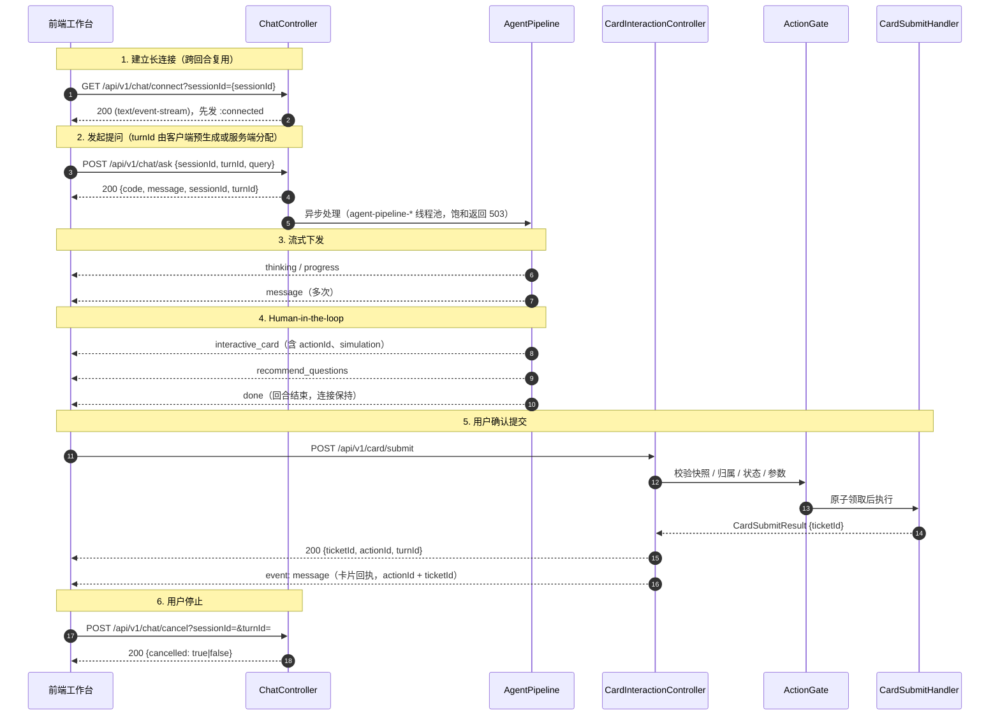

# 前后端接口与 SSE 事件流协议契约

> **文档定位**：前后端通信的**唯一事实标准**。代码（`SseEventType`、`SsePacket`、各 Controller、`frontend/src/types/chat.ts`）与本文不一致时，以本文为准修正代码或同步修订本文。
>
> **基线**：2026-10-20。本文描述**当前代码实际行为**；尚未实现的目标能力单独标注 📐，并在文末「已知偏差」列明。实现状态总表见 [13](./13-实现状态矩阵与文实一致性登记.md)。
>
> **命名原则**：协议只使用通用命名，业务语义通过 `cardType` 与业务透传参数承载。示例取自当前参考业务（智能运维排障）。

---

## 1. 通信模型

系统采用 **HTTP REST（上行）+ Server-Sent Events（下行）**：

- **下行通道（Server ➔ Client）**：SSE 长连接，推送思考链、进度、文本流、交互卡片、推荐追问与回合结束信号。
- **上行通道（Client ➔ Server）**：HTTP POST 投递提问、取消回合、提交卡片。
- **身份**：只来自宿主容器注入的 `Principal`。`/api/v1/**` 默认拒绝：无 `Principal` 返回 `401 AUTHENTICATION_REQUIRED`，无 `WebAccessPolicy` 返回 `403 ACCESS_POLICY_NOT_CONFIGURED`，策略拒绝返回 `403 ACCESS_DENIED`。`X-User-Id`、`X-Forwarded-For` 不构成身份。仅 `demo` profile 在本机来源（`127.0.0.1`/`::1`）放行匿名。

---

## 2. 交互时序



---

## 3. HTTP 接口（数据面）

### 3.1 建立 SSE 连接 ✅

- **路径**：`GET /api/v1/chat/connect`
- **参数**：

  | 参数 | 类型 | 必填 | 说明 |
  | :--- | :--- | :--- | :--- |
  | `sessionId` | String | 是 | 1~128 字符。同一 `sessionId` 重复连接时旧连接被关闭，且不会误删新连接 |

- **返回**：`text/event-stream`。建连后立即发送注释帧 `:connected` 刷新响应头；之后每 15s 发送 `:ping` 心跳。心跳与就绪帧都不是第 9 类业务事件。

### 3.2 发送提问 ✅

- **路径**：`POST /api/v1/chat/ask`
- **请求体**：

```json
{
  "sessionId": "sess_88921a9f-4310",
  "turnId": "turn_1760410000_a1b2c3",
  "query": "order-service 最近频繁出现 504 Gateway Timeout，请协助排查",
  "userId": "SRE_ONCALL_01",
  "caseId": "CASE_10086"
}
```

  | 字段 | 必填 | 说明 |
  | :--- | :--- | :--- |
  | `sessionId` | 是 | 1~128 字符，且必须已通过 3.1 建立连接 |
  | `turnId` | 否 | 客户端预生成的回合标识（消除首个 SSE 事件早于 HTTP 响应的竞态）；未传时服务端生成并在响应中返回。最长 128 字符 |
  | `query` | 是 | 用户输入，最长 32768 字符 |
  | `userId` | 否 | 仅作业务透传，**不参与鉴权** |
  | `caseId` | 否 | 宿主页面上下文 ID（历史字段名）。📐 目标为通用 `attributes: Map<String,Object>` |

- **成功响应**：

```json
{
  "code": 200,
  "message": "请求已提交处理",
  "sessionId": "sess_88921a9f-4310",
  "turnId": "turn_1760410000_a1b2c3"
}
```

- **错误**：

  | 场景 | HTTP | `message` |
  | :--- | :--- | :--- |
  | `sessionId` 或 `query` 为空 | 400 | `sessionId 或 query 不能为空` |
  | 输入超长（`query` > 32768 或标识 > 128 字符） | 400 | `输入过长` / `turnId 过长` |
  | 尚未建立 SSE 连接 | 409 | `SSE_NOT_READY: 请先建立实时通道` |
  | 队列或线程池饱和（`AbortPolicy`） | 503 | `QUEUE_SATURATED: 系统繁忙，请稍后重试` |

> 503 是**明确拒绝**：该请求没有被受理，不会产生任何 SSE 事件，也**不会**抢占或取消上一个回合的 SSE 归属。

### 3.3 一次性调试接口 ✅

- **路径**：`GET /api/v1/chat/stream-ask?sessionId=&query=&caseId=&turnId=`
- **说明**：建连与提问合并为一次请求，便于浏览器 / Postman 调试。生产前端应使用 3.1 + 3.2。若流水线拒绝，连接上会收到一条 `error`（`message = 请求未被接收`）后关闭。

### 3.4 取消回合 ✅

- **路径**：`POST /api/v1/chat/cancel`
- **参数**（query string）：`sessionId`、`turnId`，均为必填的 1~128 字符标识；缺失或超长返回 400，**不回退**为取消会话当前任务。

```json
{ "code": 200, "turnId": "turn_A", "cancelled": true }
```

- `cancelled=true`：匹配的活动回合已接受取消并发起中断。
- `cancelled=false`：未取消该回合（已结束、不存在，或当前已不是该 `turnId`）。
- **语义边界**：HTTP 成功、本地界面停止、第三方 I/O 已停止是三种不同状态。本接口不撤销已提交的写操作，也不是卡片的「放弃」接口。客户端在关闭抽屉或传输中断时，会按**原 turnId** 追加一次取消尝试。

### 3.5 提交交互卡片 ✅

- **路径**：`POST /api/v1/card/submit`
- **请求体**：

```json
{
  "actionId": "act_9f8a32b14e9a",
  "sessionId": "sess_88921a9f-4310",
  "cardType": "TROUBLESHOOT_ACTION",
  "formValues": {
    "service": "order-service",
    "action_type": "KILL_SLOW_SESSION",
    "target_identifier": "trx_10423",
    "reason": "连接池打满，终止阻塞慢事务"
  }
}
```

- **成功响应**：

```json
{
  "code": 200,
  "message": "已在服务 [order-service] 执行应急处置 [KILL_SLOW_SESSION]",
  "ticketId": "OPS-20261014-8821",
  "cardType": "TROUBLESHOOT_ACTION",
  "actionId": "act_9f8a32b14e9a",
  "turnId": "turn_1760410000_a1b2c3"
}
```

- **错误码**：

  | 场景 | HTTP | `errorType` | `retryable` |
  | :--- | :--- | :--- | :--- |
  | `actionId` 不存在 / 已过期（TTL 15 分钟） | 400 | `CARD_NOT_FOUND` | false |
  | 参数为空 / 超长 / 只读字段被篡改 / 越界 / 未知字段 / 不支持的 `cardType` | 400 | `INVALID_SUBMISSION` | true |
  | 跨会话提交他人卡片 / `cardType` 与签发记录不符 / 未开放模拟提交 / 真实写未启用 / 缺少认证身份 | 403 | `CARD_FORBIDDEN` | false |
  | 卡片已提交或正在执行（状态不是 `ISSUED`） | 409 | `CARD_STATE_CONFLICT` | false |
  | 执行开始后未确认成功（结果未知） | 500 | `EXECUTION_UNKNOWN` | **false** |
  | 处理器能证明外部副作用尚未发生（`CardNotExecutedException`） | 500 | `EXECUTION_REJECTED` | **true** |
  | 其他未预期异常 | 500 | `SUBMISSION_ERROR` | false |

- **服务端校验（✅ 已实现）**：`actionId` 必须由服务端签发且属于当前 `sessionId`；卡片必须处于 `ISSUED` 且未超过 15 分钟有效期；处理器按**签发记录**中的 `cardType` 选择，不信任请求体；`editable=false` 字段与签发快照严格比对；可编辑字段满足 `minLimit`/`maxLimit`/`required`；按白名单重建执行参数（忽略客户端夹带的 `operator` 等字段）。校验通过后才把状态原子领取为 `SUBMITTING`。

- **幂等与容量**：同一 `actionId` 同时只有一次有效领取；终态记录保留 1 小时；存储上限 10000 张，满容量拒绝新签发（不会淘汰活跃提案或 `EXECUTION_UNKNOWN`）。

### 3.6 快捷指令面板 ✅

- **路径**：`GET /api/v1/commands/palette`
- **说明**：返回可用的 L1 快捷指令列表，供前端输入 `/` 或 `#` 时弹出。
- **响应项**（`CommandPaletteItem`）：`code`、`prefix`、`name`、`template`、`description`、`targetType`、`icon`。

---

## 4. HTTP 接口（控制面）✅

> 控制面与数据面使用同一套默认拒绝策略；宿主必须通过 `WebAccessPolicy` 区分管理员与普通用户。

### 4.1 L1 规则管理 `/api/v1/admin/rules`

| 方法 | 路径 | 说明 |
| :--- | :--- | :--- |
| `GET` | `/` | 规则列表（按优先级升序） |
| `GET` | `/stats` | 规则总数 / 启用数 / 内存生效数、累计命中、快照健康状态与被跳过的异常规则 |
| `POST` | `/` | 新增规则 |
| `PUT` | `/{id}` | 修改规则 |
| `PUT` | `/{id}/toggle` | 启用 / 禁用切换 |
| `DELETE` | `/{id}` | 删除规则 |
| `POST` | `/reload` | 手动触发热重载 |

写操作完成后发布本地热重载事件，并经 `L1ClusterSync` 通知集群；响应中带 `clusterSync` 字段说明同步结果。

**当前限制（见 [13](./13-实现状态矩阵与文实一致性登记.md)）**：`target_type` 只有 `STATIC_TEXT` 与 `TOOL` 有执行器；`WORKFLOW` 或 `INTERACTIVE_CARD` 在创建/修改时直接返回 400，不会再产生「配置成功但运行时被静默放行」的规则。

### 4.2 智能体注册中心 `/api/v1/admin/agents`

| 方法 | 路径 | 说明 |
| :--- | :--- | :--- |
| `GET` | `/` | 智能体列表（系统核心优先） |
| `GET` | `/{agentCode}` | 智能体详情 |
| `POST` | `/` | 新增业务智能体（创建后直接为 `ONLINE`） |
| `PUT` | `/{agentCode}` | 修改人设、模型、工具等元数据（`version + 1`） |
| `POST` | `/{agentCode}/status` | 生命周期流转；转为 `DEPRECATED`/`OFFLINE` 前做 L1 规则依赖审计 |
| `DELETE` | `/{agentCode}` | 始终返回 400（RULE-06 禁止物理删除），提示改用状态流转 |

**当前限制**：状态接口按 `AgentStatus.canTransition` 强制迁移矩阵（`DRAFT→ONLINE/OFFLINE`、`ONLINE→DEPRECATED`、`DEPRECATED→ONLINE/OFFLINE`、`OFFLINE→ONLINE`），非法跳变返回 400；依赖审计通过 `target_ref` 子串匹配规则，且不检查工作流链。

### 4.3 L2 FAQ 管理

见 `L2FaqAdminController`，本文不展开；其接口同样受 `/api/v1` 默认拒绝策略保护。

---

## 5. SSE 事件协议

### 5.1 报文格式 ✅

```text
event: <eventType>
id: <eventId>
data: <JSON>
```

- `id` 是 `SsePacket.eventId`（UUID），**不是时间戳**；同一数据包重发保留同一 `eventId`，可用于前端去重。
- `SsePacket.timestamp` 仅用于服务端观测，**不下发**到线路上。
- `data` 即 `SsePacket.data` 的 JSON。每个回合内的事件 `data` 自动携带 `turnId`（若存在）与 `sequence`。
- `sequence` 是**进程级**单调递增计数器（`AtomicLong`），保证同一回合内递增，但**不保证从 1 开始，也不保证跨重启连续**；前端只能用大小关系去重，不能假设连续。

### 5.2 事件全集（8 类）✅

| 事件 (`event`) | 产生时机 | `data` 字段 | 前端表现 |
| :--- | :--- | :--- | :--- |
| `thinking` | 智能体推理中 | `{content, turnId, sequence}` | 灰色折叠思考面板 |
| `progress` | 规则命中、工具调用、检索时 | `{stage, description, turnId, sequence}` | 步骤条 / 轻提示 |
| `message` | 正文文本流 / 卡片回执 | `{content, turnId, sequence}`；卡片回执额外带 `{actionId, ticketId, cardReceipt: true}` | 按 `turnId`/`actionId` 追加或回写文本 |
| `interactive_card` | 需要人工核验的方案 | `{actionId, cardType, title, description, fields, confirmButtonText, cancelButtonText, simulation, turnId, sequence}` | 按 `actionId` 挂载到对应回合，可多张 |
| `recommend_questions` | 回合结束前 | `{questions: string[], turnId, sequence}` | 推荐追问气泡 |
| `conversation_title` | 首轮对话后 | `{title, turnId, sequence}` | 更新会话标题 |
| `done` | 回合结束 | `{status: "completed", turnId, sequence}` | 停止对应回合加载、激活输入框 |
| `error` | 处理异常 / 超时 / 取消 | `{message, turnId, sequence}` | 回合进入错误终态并提供重试入口 |

**卡片回执不是第 9 类事件**：它复用 `message`，通过 `cardReceipt: true` 与 `actionId` 区分，且即使当前已切换到新回合也会按原 `turnId` 投递（`currentOnly=false`）。

### 5.3 Payload 样例

**`thinking`**

```json
{ "content": "未命中 L1 极速指令，MasterAgent 正在研判排障诉求并规划调度链路...", "turnId": "turn_A", "sequence": 42 }
```

**`progress`**

```json
{ "stage": "AGENT_DISPATCH", "description": "已委派专家 [日志异常分析智能体] 深入排障...", "turnId": "turn_A", "sequence": 43 }
```

**`message`**

```json
{ "content": "您好！我是智能运维与故障排查专家", "turnId": "turn_A", "sequence": 44 }
```

**`interactive_card`**（关键协议）

```json
{
  "actionId": "act_9f8a32b14e9a",
  "cardType": "TROUBLESHOOT_ACTION",
  "title": "应急止血处置确认单",
  "description": "基于日志与数据库诊断证据自动装配，关键目标已锁定，请核验后执行：",
  "fields": [
    { "fieldKey": "service", "label": "目标服务", "type": "text", "value": "order-service", "editable": false, "required": true },
    { "fieldKey": "action_type", "label": "处置动作", "type": "text", "value": "KILL_SLOW_SESSION", "editable": false, "required": true },
    { "fieldKey": "target_identifier", "label": "目标会话", "type": "text", "value": "trx_10423", "editable": false, "required": true },
    { "fieldKey": "reason", "label": "处置原因", "type": "textarea", "value": "连接池打满，终止阻塞慢事务", "editable": true, "required": true }
  ],
  "confirmButtonText": "确认执行应急处置",
  "cancelButtonText": "放弃",
  "simulation": true,
  "turnId": "turn_A",
  "sequence": 45
}
```

`fields[]` 字段说明：

| 字段 | 类型 | 说明 |
| :--- | :--- | :--- |
| `fieldKey` | String | 提交时作为 `formValues` 的 key |
| `label` | String | 展示名 |
| `type` | String | `text` / `number` / `textarea` |
| `value` | Any | 预填值（只支持不可变标量） |
| `minLimit` / `maxLimit` | Any | 数值上下限（可选） |
| `editable` | Boolean | `false` 表示服务端锁定，提交时篡改会被拒绝 |
| `required` | Boolean | 是否必填 |
| `placeholder` | String | 占位提示（可选） |

`simulation` 为 `true` 表示该卡片由 Mock 证据生成，**只能走模拟提交**；模拟证据不能批准真实写操作。

**`recommend_questions`**

```json
{ "questions": ["如何提取该异常时间窗口内的全链路分布式 Trace？", "查询该服务数据库连接池当前的活跃与空闲连接水位"], "turnId": "turn_A", "sequence": 46 }
```

**`done`**

```json
{ "status": "completed", "turnId": "turn_A", "sequence": 47 }
```

**`error`**

```json
{ "message": "TURN_TIMEOUT", "turnId": "turn_A", "sequence": 48 }
```

---

## 6. 连接生命周期

| 项 | 当前实现 ✅ | 目标契约 📐 |
| :--- | :--- | :--- |
| 长连接复用 | `/connect` 承载多个回合；`done` / `error` 只结束回合，不关闭连接 | 同左 |
| 保活 | 建连即发 `:connected`；每 15s 发送 `:ping` 注释帧 | 同左 |
| 断线 | 发送失败即移除该连接并发布 `SessionDisconnectedEvent`，**取消该会话的活动回合**；依赖浏览器 `EventSource` 自动重连 | 重连期间事件不补发；前端以 `turnId` 去重 |
| 迟到事件 | 事件在创建时固定 `turnId`；非当前回合的事件被丢弃（卡片回执除外） | 同左 |
| 多节点 | 连接表在单机内存，要求同一会话请求落在同一节点 | 网关会话亲和，或经 `SessionEventBus` 跨节点投递（见 [07 第 5.5 节](./07-内核架构设计与演进路线.md#55-多节点部署)） |
| 断点续传 | ❌ 无事件日志，`Last-Event-ID` 无法回放 | 见 [13](./13-实现状态矩阵与文实一致性登记.md) |

---

## 7. 前端集成示例

完整实现见 `frontend/src/api/sseClient.ts` 与 `frontend/src/hooks/useChatSession.ts`，核心片段：

```typescript
const eventSource = new EventSource(`/api/v1/chat/connect?sessionId=${encodeURIComponent(sessionId)}`);

const eventTypes = ['thinking', 'message', 'progress', 'interactive_card',
  'recommend_questions', 'conversation_title', 'done', 'error'];

eventTypes.forEach((type) => {
  eventSource.addEventListener(type, (e: MessageEvent) => onEvent(type, JSON.parse(e.data)));
});

// 提问：turnId 由客户端预生成，避免首个事件早于 HTTP 响应
await fetch('/api/v1/chat/ask', {
  method: 'POST',
  headers: { 'Content-Type': 'application/json' },
  body: JSON.stringify({ sessionId, turnId, query }),
});

// 取消：只在拥有该 turnId 时调用
await fetch(`/api/v1/chat/cancel?sessionId=${sessionId}&turnId=${turnId}`, { method: 'POST' });

// 卡片确认
await fetch('/api/v1/card/submit', {
  method: 'POST',
  headers: { 'Content-Type': 'application/json' },
  body: JSON.stringify({ actionId: card.actionId, sessionId, cardType: card.cardType, formValues }),
});
```

---

## 8. 已知偏差

以下行为与「理想契约」不一致，已登记在 [13](./13-实现状态矩阵与文实一致性登记.md)，修复前不要按理想语义实现客户端：

1. **只有显式声明才能区分「确定未执行」**。处理器抛 `CardNotExecutedException` 时，卡片释放回 `ISSUED` 并返回 `EXECUTION_REJECTED`（可重试）；返回 `CardSubmitResult.fail` 或抛其他异常时，仍按 `EXECUTION_UNKNOWN` 处理（`failureResponseIsNotProofOfNoSideEffects` 保障该保守语义）。客户端对 `EXECUTION_UNKNOWN` 必须按终态处理。
2. **无事件回放**。`id` 虽为唯一 `eventId`，但没有事件日志，重连后无法补发；`Last-Event-ID` 请求头当前无效。
3. `sequence` 为进程级计数器，不是每回合从 1 开始。
4. `conversation_title` 事件已定义并下发，但前端 UI 尚未消费。
5. `caseId` 是历史字段名，目标契约为通用 `attributes`。

---

## 9. 变更记录

| 日期 | 版本 | 变更 |
| :--- | :--- | :--- |
| 2026-10-14 | v1.0 | 初版：8 类事件、卡片提交、控制面接口 |
| 2026-10-15 | v1.1 | 补充 `/cancel` 契约（见 `11`） |
| 2026-10-20 | v2.0 | 按当前代码重写：修正 `id` 为 `eventId`、补 409/503、补卡片回执字段与 `simulation`、补错误码表与已知偏差、移除 GitHub 示例 |
