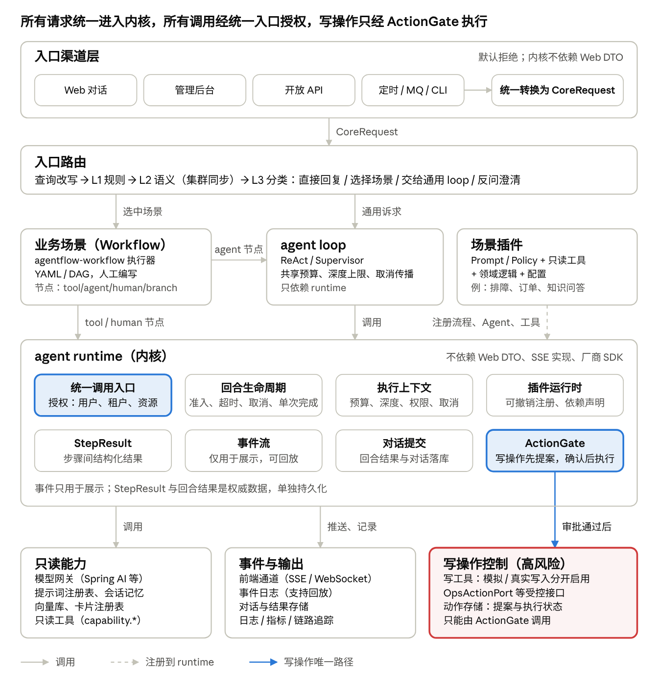
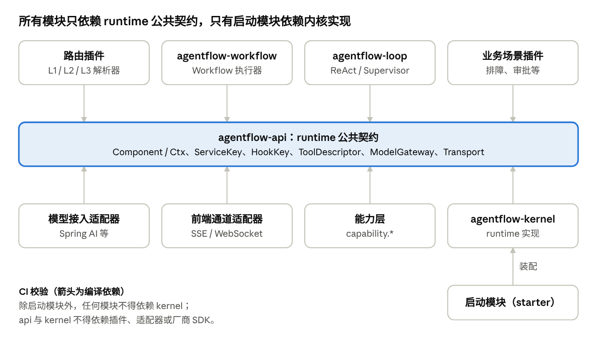
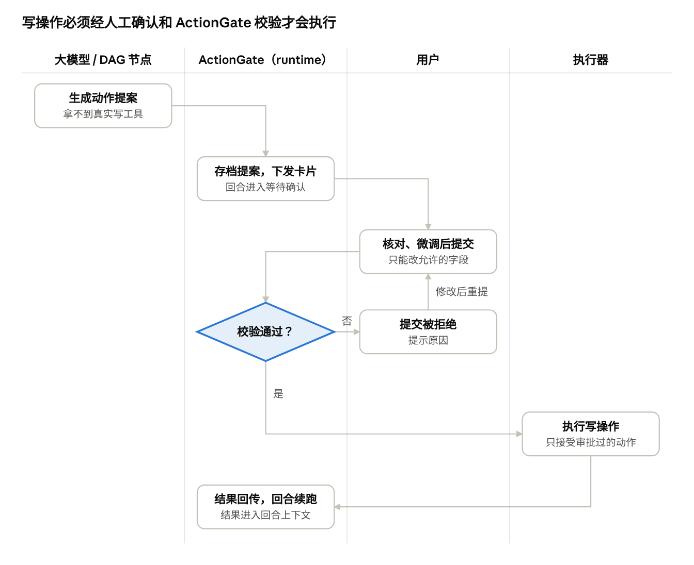
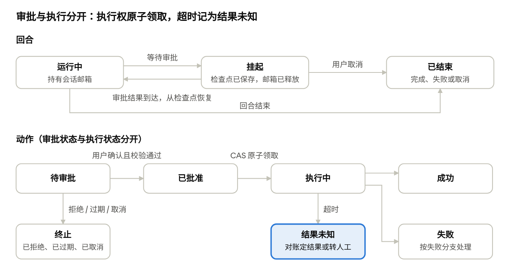

# AgentFlow 分层架构设计：各层职责与整体设计思想

Oct 13, 2026 · @oceanuskai

## 设计目标与整体思想

AgentFlow 的定位是通用的企业级 Multi-Agent 流式微内核：内核只定义协议和扩展点，业务以插件形式接入，内核里没有一行业务代码。下面五条思想决定了分层方式。

1. **微内核 + 插件。** 内核只保留回合、事件、工具、智能体、钩子这几个契约。L1/L2/L3 路由、模型接入、SSE 推送都是可替换的插件，框架自带的默认实现也不例外。
2. **确定性流程与自主推理分离。** 能写成固定步骤的，交给 YAML/DAG 由人编写；需要大模型判断的，才交给 agent loop。DAG 只由人编写，不让大模型生成。
3. **在明确的信任边界内，由运行时强制保证安全。** 插件代码属于受信边界；模型输出、流程配置、用户提交属于不受信输入。不受信输入发起的调用一律经统一调用入口授权；写操作只能以“提案”形式出现，经人工确认后才执行。
4. **依赖倒置、可撤销、须声明。** 编译依赖以 runtime 公共契约为中心，调用关系自上而下，两者都没有环。借鉴 Cordis 的范式：组件在框架内的注册与资源都能随组件卸载而撤销，但不包括已发生的外部业务写入；通过 runtime 获取的服务和工具必须事先声明，没声明就拿不到。
5. **模型接入与前端通道分离。** 模型接入负责调用大模型厂商；前端通道负责通过 SSE / WebSocket 向前端推送事件。两者变化的原因不同，都通过 SPI 挂载，runtime 不绑定任何厂商 SDK 或传输协议。

## 分层架构总览

业务场景有两条下行路径：

agent 节点经 agent loop，tool / human 节点直连 runtime。两条路径在 runtime 汇合，所以写操作统一由 ActionGate 把关。适配器和能力层都朝上依赖 runtime 的契约，runtime 不认识它们的具体实现。本图是调用关系图，编译依赖见“依赖规则与关键约束”。

## 各层职责

六个模块各管一件事，边界靠“不负责什么”来划清。

| 层 | 负责 | 不负责 | 对外契约 |
| --- | --- | --- | --- |
| 入口 / 路由 | 请求入口处的意图分流：L1 规则 → L2 语义 → L3 分类，决定直接回复、选择业务场景、交给通用 agent loop，或反问澄清 | 不执行业务，不调用写工具 | `IntentResolver` → `Resolution`（直接回复 / 工具直通 / 委派 / 澄清） |
| 业务场景（Workflow） | 用 YAML/DAG 描述固定流程，如故障排查 SOP、审批流；节点分 tool、agent、human、branch 四类 | 不直接调模型 SDK，不直接推 SSE，不绕过 ActionGate | 流程定义（YAML），由独立的 Workflow 执行器模块解释执行；可注册为 runtime 工具供 loop 调用 |
| agent loop | 大模型自主推理循环（ReAct / Supervisor）：思考、选工具、看结果、决定下一步；控制轮次、Token 预算、中途停止 | 不知道具体业务流程，不直连模型厂商 | `Agent.run(input, scope)` 返回事件流 |
| agent runtime（内核） | 回合生命周期、统一调用入口（授权）、事件流、工具注册表与 ActionGate、状态与记忆、钩子链、插件运行时 | 不含业务名词、厂商 SDK、具体存储和传输协议 | `Component` / `Ctx`、`ToolDescriptor`（副作用分级）、`HookKey`、`ModelGateway` / `Transport` SPI |
| 适配器 | 模型接入：调用大模型厂商（Spring AI 或其他 SDK）；前端通道：通过 SSE / WebSocket 向前端推送事件 | 不含编排和业务逻辑 | 实现 `ModelGateway`、`Transport` |
| 能力层 `capability.*` | 领域原子能力：Port + Adapter + Tool，如日志检索、数据库诊断、运维处置 | 不编排流程，不感知业务场景 | 按读 / 写 / 高危分级，注册进 runtime 工具表 |

## 依赖规则与关键约束

七条规则保证分层不会退化，其中第 3 条最关键。

1. **编译依赖指向 runtime 契约，调用自上而下。** 所有模块只依赖 runtime 的公共契约（api 模块）；runtime 不感知 loop、业务场景和具体实现；能力层不感知业务场景。总览图是调用关系，编译依赖见下图。
2. **允许业务场景跨层直连 runtime。** 确定性步骤（固定查询、推送进度、人工确认节点）不走大模型，延迟低、成本低、可复现。直连时只能使用 runtime 的公开契约。
3. **ActionGate 必须放在 runtime。** 既然存在跨层直连，审批只能放在两条路径的交汇处。写工具只以“提案”形式暴露，用户确认后才会真正执行。用户与资源授权由统一调用入口负责，不属于 ActionGate。
4. **loop 调用业务流程，采用依赖倒置。** 业务流程注册为 runtime 里的一个工具，loop 在运行时按名字发现并调用，不直接依赖业务层。
5. **外部依赖一律经 SPI 挂载。** 模型、传输、存储都可以替换，内核不引用任何具体实现。
6. **依赖必须声明。** 组件在 `inject` 中声明要用的服务和工具，没声明的在运行时拒绝访问。智能体的工具白名单就是它的依赖声明。这一约束只覆盖经 runtime 获取的服务；插件自持的客户端由信任边界约束。
7. **内核纯净由 CI 守护。** 用 ArchUnit 检查：api 与内核不引用插件、适配器和厂商 SDK；除启动模块外，任何模块不得依赖内核实现；场景包不得引用数据库、HTTP、运维 SDK 客户端。违反即构建失败。

编译依赖都指向 api 模块，调用关系则自上而下（见总览图）；两张图各自无环。

## 信任边界与统一调用入口

runtime 的安全保证只在明确的信任边界内成立：插件代码受信，模型输出、流程配置和用户提交不受信。审批由 ActionGate 负责，授权与执行约束由统一调用入口负责。

| 结论 | 依据 |
| --- | --- |
| 插件代码属于受信边界，靠代码评审和依赖准入控制，不靠运行时隔离 | Java 无法对同进程插件做沙箱隔离：SecurityManager 在 JDK 17 被废弃（JEP 411），JDK 24 永久禁用（JEP 486） |
| 外部系统凭证只由能力层适配器持有；场景插件和智能体不得自持数据库、HTTP、运维 SDK 客户端 | 写能力集中在少数受审查的适配器中，由 ArchUnit 校验 |
| 模型调用、Workflow 直调、卡片提交、恢复任务、重试任务，全部经同一个调用入口执行 | 任何路径都不能绕过授权与审批 |
| 调用入口在实际执行前检查用户、租户、目标资源和操作权限，按执行时的实时策略判断 | 审批后被撤销的权限必须生效，不能按旧快照放行 |
| 工具白名单与用户资源授权分别校验，两者都通过才执行 | 白名单只说明“这个智能体能用这个工具”，不说明“这个用户能动这个资源” |
| 委派给子 Agent 或 Workflow 时，权限取父子交集，只能收窄不能扩大 | 防止通过委派提升权限 |
| 通用 SQL、Shell、HTTP 工具不得标记为“读”；要么拆成专用工具，要么按调用参数动态分级，并用只读凭证兜底 | 通用工具的副作用随参数变化，注册时分级无法覆盖 |
| 授权与 ActionGate 由内核固定在调用入口上，不作为可卸载的钩子 | 强制安全检查不能被插件卸载或调换顺序 |

## ActionGate：写操作审批

ActionGate 是 runtime 内的写操作审批关口。凡是会改变外部系统状态的操作，都必须先生成提案，经人工确认，再由 ActionGate 校验通过后才会执行。它只管审批；用户与资源授权由统一调用入口负责，执行状态与一致性见“回合挂起、恢复与动作一致性”。

校验不通过时，用户修改后可以重新提交；只有校验通过的动作才会到达执行器。

| 结论 | 依据 |
| --- | --- |
| 工具注册时标明副作用级别：读 / 写 / 高危 | ActionGate 据此判断哪些工具需要审批 |
| 写工具和高危工具不暴露给大模型，模型只能调用对应的“提案”工具 | 从机制上杜绝模型绕过确认；当前 `OpsActionTool` 直接挂给模型，就是反例（已核对源码：TroubleshootSubAgent.java 第 90-91 行） |
| 提案在服务端存档：参数快照、允许修改的字段、有效期 | 目前“只读字段”只在前端生效，提交时可以被篡改 |
| 审批绑定最终参数、目标资源、工具版本和有效期，审批后任何修改都使其失效、需重新审批；提交时校验：提案存在且未过期、只改了允许的字段、提交人有审批权限、没有重复提交 | 防止“批的是 A、执行的是 B”；防伪造、防篡改、防重复提交。防重复执行另由执行协议保证（原子领取 + 幂等键） |
| 高危操作可要求双人复核，两人复核的必须是同一动作版本 | 按风险等级控制审批强度 |
| “等待人工确认”是回合的正式状态，确认后继续执行同一回合；等待期间回合挂起并释放会话邮箱，不阻塞 | 写操作的结果能回到原上下文，供后续分析使用 |
| 放在 runtime，而不是 agent loop | 业务场景可以跨层直连 runtime，审批只能放在两条路径的交汇处 |
| 执行器只接受审批过的动作对象，这种对象只能由 ActionGate 创建 | 从类型系统层面防止绕过审批直接执行 |
| 卡片只负责展示与收集提交，复用现有的 `InteractiveCard` 与 `CardSubmitHandler` | 卡片下发和提交处理已有实现（已核对源码 core/card/）；复用卡片不等于恢复机制已完成，回合状态与恢复独立设计 |

## 回合挂起、恢复与动作一致性

等待审批时，回合挂起而不是阻塞；审批状态与执行状态分开管理；执行结果不明时走对账，不盲目重试。

| 结论 | 依据 |
| --- | --- |
| 等待审批时：保存检查点 → 回合进入挂起状态 → 释放会话邮箱；审批结果作为一条新消息进入邮箱，回合从检查点恢复 | 若在邮箱内阻塞等待，审批消息排在同一邮箱后面，永远得不到处理 |
| 检查点持久化，包含流程位置、上下文、待审批动作、相关组件与工具版本、子任务状态 | 进程重启后可以恢复 |
| 拒绝、过期、取消、重复确认、进程重启都定义为显式状态迁移；只有有效迁移才能让回合继续 | 过期或已取消的审批不能被执行 |
| 审批状态（待审批 / 已批准 / 已拒绝 / 已过期 / 已取消）与执行状态（执行中 / 成功 / 失败 / 结果未知）分开管理 | 批准了不等于执行了 |
| 执行权通过 CAS 原子领取：只有成功把状态从“已批准”改为“执行中”的一方才能执行 | 并发提交同一审批时，只有一次有效迁移 |
| 每个业务动作使用稳定的幂等键，并传给外部系统 | 外部写成功、结果未落库就崩溃时，恢复后不会重复执行 |
| 执行超时记为“结果未知”，走查询对账或人工处置，不自动重试 | 超时可能已经执行成功 |
| 执行前复查目标资源的前置条件 | 审批到执行之间，资源状态可能已经变化 |
| 外部系统不支持幂等时，在工具描述中声明实际能提供的保证与补偿方式 | 不承诺做不到的一致性 |
| 业务补偿是独立契约，与框架的可撤销效应无关 | 可撤销效应只管理框架内的注册与资源，不会撤销已发生的外部写入 |

## 父子执行契约

Supervisor、子 Agent、Workflow 之间的嵌套调用共用同一个执行上下文，预算、权限和取消信号沿调用树传递。

| 结论 | 依据 |
| --- | --- |
| 统一执行上下文携带：父子关系、调用深度、共享预算、权限范围、取消信号 | 嵌套调用的约束需要统一的承载者 |
| 设置调用深度上限，并检测同一回合内对同一 Workflow 的重入 | 编译依赖无环，不代表运行时不会递归：Agent → Workflow → Agent → 同一个 Workflow |
| 预算是整棵调用树的总额度，子调用从父额度中扣减，不重新获得完整预算 | 防止总成本突破父回合的限制 |
| 权限取父子交集 | 委派不能扩大权限 |
| 取消信号沿调用树向下传播 | 用户点停止或父回合失败时，子任务一并停止 |
| 子任务失败时，由父节点按配置选择：继续、失败或转人工处理 | 失败语义必须显式 |
| 内部子调用在当前回合内直接执行，不重新排入会话邮箱；邮箱只接收外部消息 | 父调用在邮箱内等待子调用，而子调用又排在同一邮箱后面，会互相等待 |
| 会话串行只约束状态变更；独立子任务可以并行计算，结果回到回合时串行合并并去重 | 兼顾一致性与并行效率 |

## Workflow 执行器与端到端示例

Workflow 由独立模块 `agentflow-workflow` 解释执行；runtime 只提供调用、审批、检查点和事件这些通用机制，内核不演变成工作流引擎。

| 结论 | 依据 |
| --- | --- |
| Workflow 执行器负责：解释 YAML、保存节点状态、超时重试、失败分支、流程版本 | 职责集中在一个模块，将来可整体替换为外部工作流引擎 |
| runtime 负责：统一调用入口、ActionGate、检查点存储、事件流 | 内核保持通用 |
| 节点契约：输入输出 Schema、变量作用域、超时、重试次数、失败分支 | 流程可校验、可测试 |
| 流程定义带版本号；挂起中的实例按启动时的版本恢复，新版本只对新实例生效 | 修改流程不影响正在等待审批的实例 |

端到端示例（故障止血）：

| 步骤 | 节点类型 | 负责模块 | 失败路径 |
| --- | --- | --- | --- |
| 1. 查询服务错误日志（固定参数） | tool | Workflow 执行器 → 统一调用入口 → 日志能力 | 按节点配置重试，仍失败则走失败分支 |
| 2. 分析根因，提出止血方案 | agent | Workflow 执行器 → agent loop | 超预算或超时：转人工处理 |
| 3. 人工确认止血方案 | human | ActionGate：存档提案、下发卡片；回合挂起 | 拒绝或过期：流程结束并记录结果 |
| 4. 执行写操作（如终止慢查询会话） | tool（写） | ActionGate 原子领取 → 统一调用入口 → 运维能力 | 结果未知：查询对账；失败：转人工处理 |
| 5. 结果归入原回合 | — | Workflow 执行器 → 事件流 | 推送失败：事件日志保留，客户端重连后回放 |

## 运行时内核与 SPI 设计

SPI 借鉴 Cordis 的设计，用 Java 自研实现；不引入 Cordis 依赖，也不更换技术栈。依据：[Cordis 源码](https://github.com/cordiverse/cordis/tree/c261dd2c13d65b1994adb1cdc10d7dba61542523)（4.0.0-rc.10，commit c261dd2；借鉴 `packages/core/src` 下的 `fiber.ts`、`reflect.ts`、`events.ts`、`registry.ts`）与[论文](https://arxiv.org/abs/2608.25512)。

SPI 分为两类，分别采用不同的机制：

| 类型 | 适用对象 | 落地方式 | 依据 |
| --- | --- | --- | --- |
| 单槽位服务 | 模型网关、会话 / 回合 / 动作存储、事件日志、事件总线、向量库 | `ServiceKey<T>` + `ctx.provide` / `ctx.get` | 同一时刻只有一个实现生效 |
| 多实现扩展点：钩子 | 意图解析链、拦截器、旁路观察者 | `HookKey<I, O>`，分别采用 serial / waterfall / parallel 调用模式 | 多个实现需要按顺序或并行协作 |
| 多实现扩展点：注册表 | 工具、智能体、传输通道、卡片处理器 | 注册表服务 + `ScopedService.forCaller` | 注册记在调用方插件上，插件卸载时自动注销 |

关键设计决策：

| 决策 | 依据 |
| --- | --- |
| 所有注册都是可撤销效应：返回 `Disposable`，卸载时逆序撤销 | 插件下线后不残留任何注册；仅限框架内的注册与资源，不含外部业务写入（业务补偿另行定义） |
| 依赖必须在 `inject` 中声明，未声明就访问会报错 | 智能体的工具白名单即依赖声明，实现最小权限；只覆盖经 runtime 获取的服务，插件自持的客户端由信任边界约束 |
| 依赖的提供方变化时，依赖方自动重载（epoch 机制） | 更换模型网关或存储无需重启；历史状态（待执行动作、检查点、事件日志）的迁移需单独设计 |
| 同一隔离域内，同名服务重复注册直接报错；默认实现由装配配置启用，不做隐式覆盖 | 同一时刻只有一个提供方，避免“到底注入了哪个”的歧义 |
| 提供 `ctx.isolate` 与 `ctx.intercept` | 多租户使用不同实现；按作用域覆盖配置 |
| 注册服务时可附带可用性检查 `check()` | 例如缺少 API Key 时，模型服务视为不可用，依赖方不激活 |
| 采用声明式装配：配置树 + 差异调整 | Agent Hub 的上下线、灰度、回滚走同一套机制 |
| `ServiceKey` 携带契约版本号 | 插件以独立 jar 分发时，可以校验兼容性 |
| 不做代码热替换，只热更新配置与插件实例 | JVM 上 ClassLoader 热替换的代价远大于收益 |
| Spring 只管理基础设施单例，由根节点统一提供；组件何时激活由运行时决定 | 两套容器职责不重叠 |

## 线程模型

控制面单线程，数据面按会话串行。控制面不采用 Netty 的多 EventLoop 分片，单线程本身就是 Netty reactor 模型在 EventLoop 数量为 1 时的特例。

| 范围 | 结论 | 依据 |
| --- | --- | --- |
| 控制面：插件生命周期 | 所有生命周期迁移在一个专用线程上串行执行；不按 Fiber 分片 | Fiber 之间通过服务依赖级联变更，无法独立分片；服务表和钩子表需要全局一致；跨线程互相等待会死锁；生命周期事件很少，并行没有收益 |
| 控制面：执行纪律 | 生命周期线程禁止阻塞：需要 I/O 的 `apply` 返回 `CompletionStage`，完成后把结果投递回循环；测试中接入 BlockHound，并通过 nonBlockingThreadPredicate 把生命周期线程标记为禁止阻塞（默认只识别 Reactor 的非阻塞线程）；另加一个故意阻塞的测试，确认检测生效，并验证与目标 JDK 的兼容性 | 照搬 Netty EventLoop 的纪律；一个插件阻塞，就会卡住所有生命周期操作 |
| 数据面：读取 | 每次生命周期变更后，发布一份不可变的 `RuntimeSnapshot`；回合全程读同一份快照，无锁 | 沿用现有 `L1RuleRegistry` 的 `AtomicReference` 写时复制模式 |
| 卸载安全 | 租约只保护正在执行的调用，并与快照原子获取；组件退役顺序为：停止发放新租约 → 等存量调用完成 → 释放资源。等待审批的回合不持有租约，靠提案中记录的工具版本锁定语义（见“插件生命周期版本规则”） | 流式输出中途报错不可接受；等待审批可能持续很久，若持有租约会拖住卸载 |
| 数据面：会话 | 每个会话一个串行邮箱（actor 模式），运行在虚拟线程上（需要 JDK 21）；不同会话并行；不采用固定绑定 EventLoop。等待审批时挂起并释放邮箱；按下游服务分别设置信号量、限流和超时 | 会话之间相互独立，适合 reactor 思路；但工具调用和模型调用可能阻塞，固定绑定 EventLoop 会造成队头阻塞。虚拟线程只提升并发承载能力，不会限制对模型和数据库的访问并发（JEP 444） |
| 演进条件 | 大规模多租户、租户之间几乎不共享服务时，再按隔离域给控制面分片 | 共享服务一多，就会回到跨分片协调的问题 |

## 插件生命周期版本规则

新回合用最新快照，存量调用用开始时的版本跑完；等待中的回合绝不隐式切换实现。

| 结论 | 依据 |
| --- | --- |
| 新回合读取最新快照；正在执行的调用继续使用开始时的版本 | 版本选择规则明确 |
| 组件退役顺序：停止发放新租约 → 等存量调用完成 → 释放资源 | 避免释放仍在使用的资源 |
| 租约随快照原子获取，并覆盖工具及其依赖的网关、存储等服务 | 避免“读到快照、拿到租约前组件已被释放”的竞态 |
| 等待审批的回合恢复时，若工具版本已变化：默认重新审批，无法重新审批则取消；不隐式替换实现 | 已批准动作的语义不能悄悄改变 |
| 异步初始化完成时先校验 epoch，过期的结果丢弃，并清理已创建的资源 | 避免已退役组件重新发布服务；Cordis `fiber.ts` 中 `_reload` 即按此处理 |
| 部分初始化失败时，逆序撤销已完成的注册 | 不留下半初始化状态 |
| 权限撤销按执行时的实时策略生效，不按旧快照判断 | 安全优先于版本稳定 |

## 实现前需定稿的契约

以下契约必须在编码前定稿，其中四项已有结论。推进顺序：执行协议 → 状态与一致性的数据设计 → SPI 与接口契约 → 原型验证。

| 主题 | 需要定义的内容 | 当前结论 |
| --- | --- | --- |
| 事件流 | 事件序号范围、状态与事件的一致性、重连去重、慢客户端背压、日志保留期 | 待定 |
| 钩子链 | 执行顺序、超时、异常、否决规则 | 授权与 ActionGate 不走钩子，由内核固定在调用入口；其余待定 |
| 异步激活 | epoch 校验、迟到结果丢弃与清理、部分失败后的逆序撤销 | 见“插件生命周期版本规则” |
| 部署形态 | 多实例下的会话归属、接管、防止双重执行 | 首期只支持单实例，网关按会话亲和路由；多实例接管放到后续阶段 |
| SPI 作用域 | 服务解析顺序、覆盖优先级、不可用时的行为 | 同一隔离域、同一契约只有一个提供方；不做隐式覆盖；不可用时依赖方不激活 |
| 模型网关 | 流式响应、工具调用片段、用量统计、取消、错误与重试 | 待定 |

## 原型验收场景

原型必须通过以下 8 个场景，才进入生产实现。

- [x] 并发提交同一审批：只有一次有效状态迁移，外部动作只触发一次
- [x] 外部写成功、结果落库前崩溃：恢复后识别已有结果或进入对账，不盲目重做
- [x] 等待确认时进程重启：回合可恢复，过期或已取消的审批不能继续执行
- [x] 等待确认期间卸载工具：按版本规则重新审批或取消，不隐式切换实现
- [ ] 审批后权限被撤销：执行前按实时授权拒绝
- [ ] 嵌套 Agent / Workflow 调用：共享预算、深度上限、取消传播生效，没有同邮箱互相等待
- [ ] 客户端重连或消费过慢：事件按约定恢复，缓冲与日志增长受控
- [ ] 异步激活返回前组件已退役：迟到结果不重新发布服务，已创建的资源被清理

## 落地状态

截至 2026-10-20（代码 `ef2047e`），19 项中 3 项已实现、7 项部分实现、9 项未实现。安全与单回合正确性基本就绪，差距集中在内核边界、统一调用入口、编排与持久化。

| 组件 | 状态 | 代码现状 | 下一步 |
| --- | --- | --- | --- |
| 入口渠道层 / CoreRequest | 未实现 | 只有 HTTP + SSE；内核直接接收 `ChatRequest` | 引入 `CoreRequest`，渠道适配器负责转换 |
| 入口路由 | 部分实现 | 查询改写、L1、L2（含集群同步）已就绪；没有反问澄清；L3 仍按关键词路由，`AgentType` 含业务编码 | L3 改为基于智能体清单的大模型路由，增加反问澄清 |
| Workflow 执行器 | 未实现 | L1 规则的 `WORKFLOW` 只是合法取值，没有执行器 | 新建 `agentflow-workflow` 模块 |
| agent loop | 未实现 | 按 `DispatchStep` 顺序执行（上限 32 步）；工具循环由 Spring AI 隐式完成 | 独立的 loop，控制轮次与预算 |
| 场景插件 | 部分实现 | `SubAgent` 以 Bean 注入，只拿只读工具；没有插件规范 | 定义插件构成与注册方式 |
| 统一调用入口（授权） | 未实现 | 模型工具、L1 工具、卡片提交三条路径各自独立；授权只在 HTTP 层和真实写操作 | 三条路径收敛到一个入口，统一授权与副作用分级 |
| 回合生命周期 | 已实现 | `TurnTaskSupervisor`：准入上限 512、截止时间、取消；终止事件只发一次 | — |
| 执行上下文 | 部分实现 | 有取消与截止时间；没有预算、调用深度、权限范围 | 按父子执行契约补齐 |
| 插件运行时 | 未实现 | 依赖 Spring 启动期装配 | 按 Cordis 范式实现 |
| StepResult | 已实现 | 步骤结构化结果，可携带动作提案 | 纳入持久化 |
| 事件流 | 部分实现 | 事件带身份标识，丢弃过期回合的事件；没有事件日志和断线续传 | 事件日志 + `Last-Event-ID` |
| 对话提交 | 部分实现 | 只有内存会话记忆 | 持久化回合结果与对话 |
| ActionGate | 部分实现 | 校验签发记录、原子领取、工具版本锁定、崩溃后幂等对账恢复（`/card/reconcile`）；模拟与真实写入分开启用；只覆盖卡片提交 | 挂到统一调用入口之后 |
| 回合挂起与恢复 | 已实现 | 下发卡片自动保存持久化 `TurnCheckpoint`（`WAITING_APPROVAL`）并释放会话槽位；审批/对账通过后恢复回合上下文，取消回合联动废止待确认卡片 | — |
| 动作存储 | 已实现 | `ActionLedgerPort` + `JpaActionLedgerAdapter`（`sys_action_ledger`），审批态与执行态分离，重启后待审批与结果未知记录可恢复 | — |
| 工具副作用分级 | 部分实现 | 写工具已去掉 `@Tool`，由边界测试守护；没有注册期分级 | 注册时声明读 / 写 / 高危 |
| 模型网关抽象 | 未实现 | 内核直接使用 Spring AI | 引入 `ModelGateway` |
| 编译依赖与 CI 守护 | 未实现 | 单模块；`core` 有 8 个文件依赖 web / infra / Spring AI；没有 ArchUnit；JDK 17 | 拆分 api / kernel，补 ArchUnit，升级 JDK 21 |
| 入口访问控制 | 已实现 | 默认拒绝，只有本机 demo profile 放行 | — |

优先级：

1. 动作存储持久化与回合挂起恢复（对应验收场景第 2、3 条）
2. 统一调用入口：三条路径收敛，统一授权与副作用分级，ActionGate 挂在其后
3. 内核去依赖：`CoreRequest`、`ModelGateway`、事件输出接口，补 ArchUnit
4. L3 路由去关键词、去业务编码，增加反问澄清
5. 事件日志与断线续传、执行上下文的预算与深度、Workflow 执行器、插件运行时
