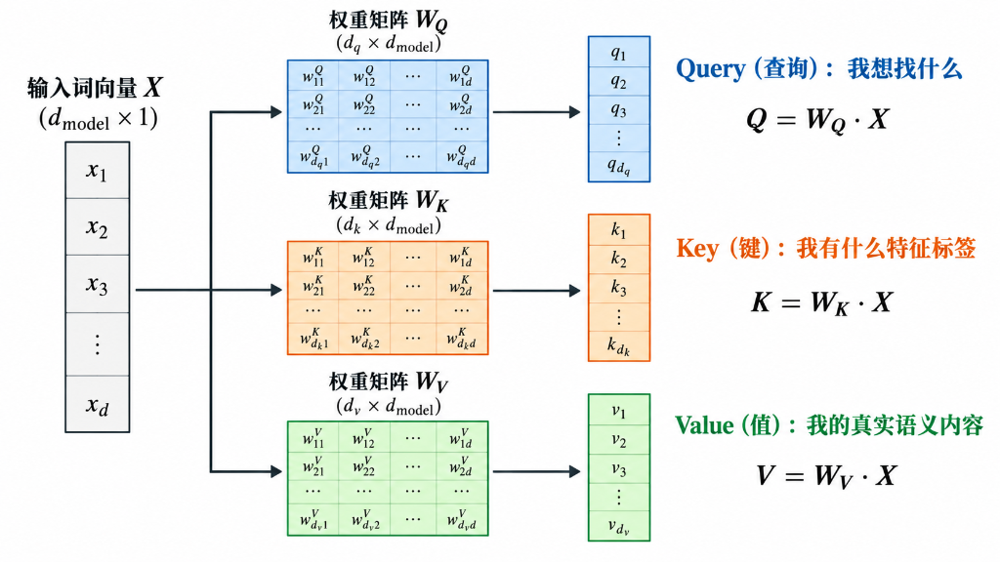
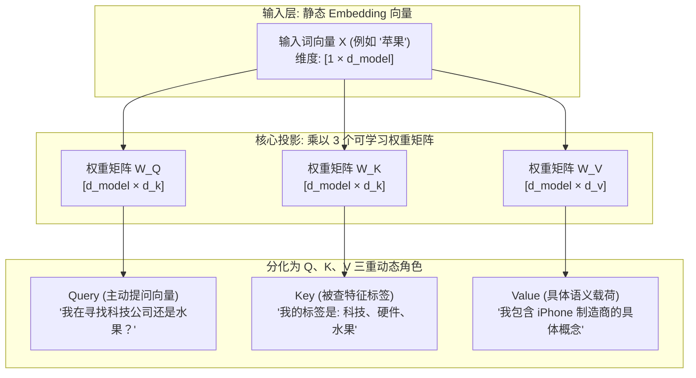
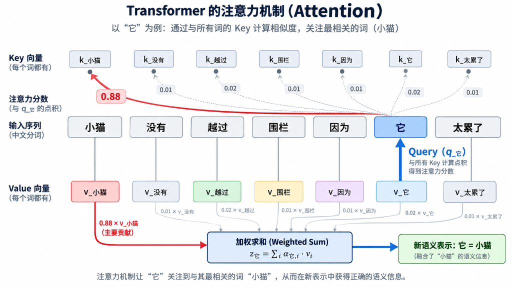
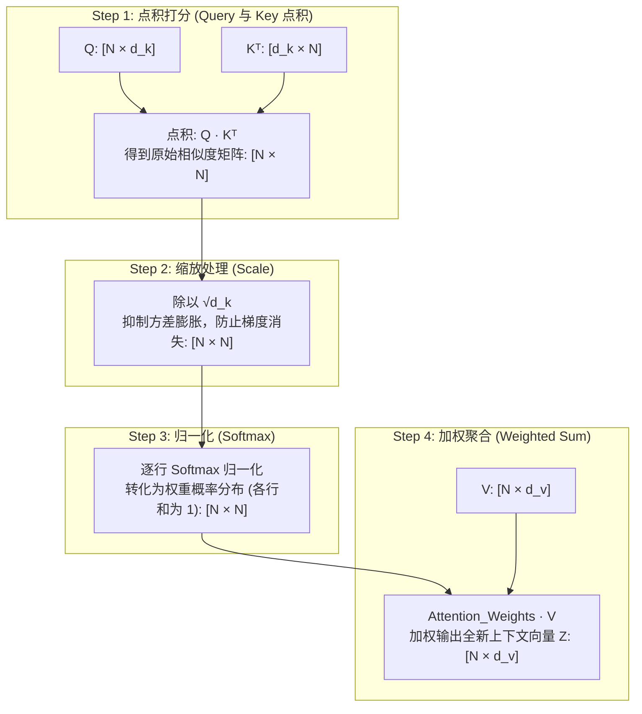
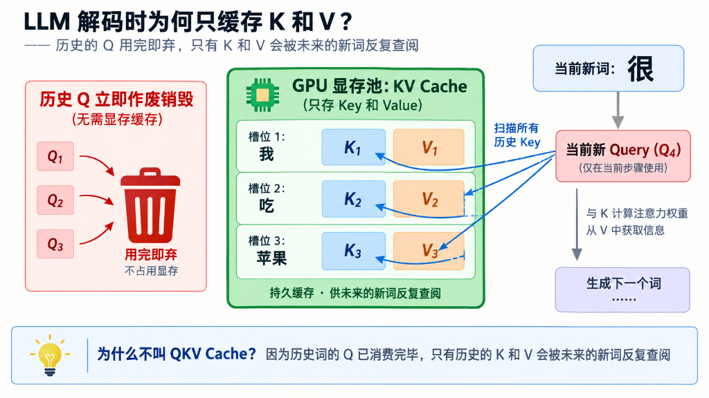
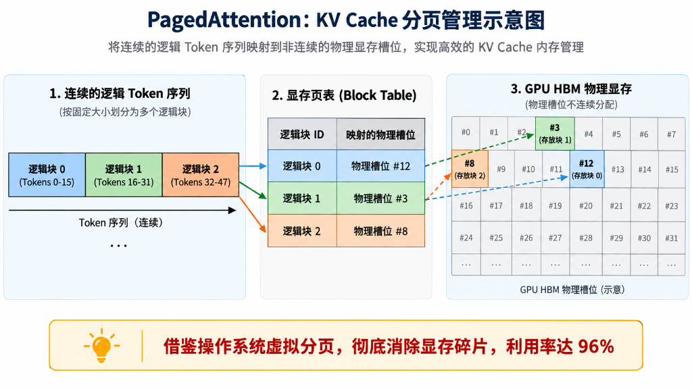
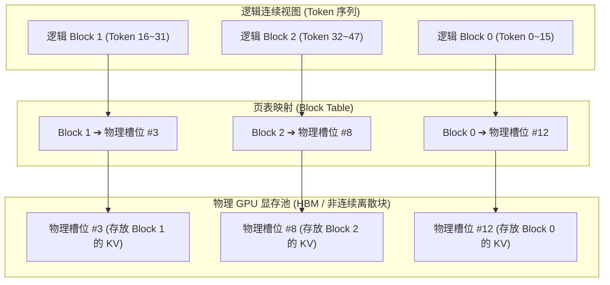
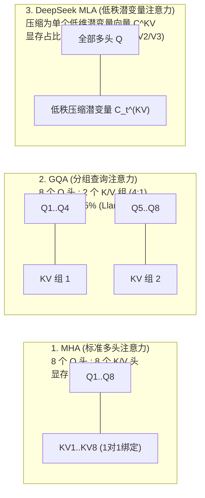

# 深入浅出 Transformer 核心：一文吃透 QKV 注意力机制与 KV Cache 底层数学逻辑

> **所属专栏**：大模型底层原理与核心概念硬核拆解  
> **核心标签**：`Transformer` `Self-Attention` `QKV原理` `KV-Cache` `PagedAttention` `MLA`  
> **面向读者**：具备编程与基本线性代数基础、希望彻底搞懂大模型内部注意力流转与推理开销的工程师与架构师。

---

## 目录
1. [引言：为什么传统神经网络“读不懂长句”？](#一-引言为什么传统神经网络读不懂长句)
2. [第一重拆解：Q、K、V 的本质与“图书检索”隐喻](#二-第一重拆解qkv-的本质与图书检索隐喻)
3. [第二重拆解：自注意力的 4 步计算流与张量形状（Tensor Shapes）](#三-第二重拆解自注意力的-4-步计算流与张量形状)
4. [第三重拆解：为什么推理缓存叫 KV Cache，而不是 QKV Cache？](#四-第三重拆解为什么推理缓存叫-kv-cache而不是-qkv-cache)
5. [第四重拆解：云厂商如何管理显存？—— PagedAttention 虚拟分页原理](#五-第四重拆解云厂商如何管理显存-pagedattention-虚拟分页原理)
6. [第五重拆解：显存瘦身演进史 —— 从 MHA 到 GQA 与 DeepSeek MLA](#六-第五重拆解显存瘦身演进史--从-mha-到-gqa-与-deepseek-mla)
7. [总结与架构心智模型](#七-总结与架构心智模型)

---

## 一、 引言：为什么传统神经网络“读不懂长句”？

在 Transformer 诞生（2017 年《Attention Is All You Need》）之前，自然语言处理的核心骨干是 **RNN（循环神经网络）** 与 **LSTM（长短期记忆网络）**。

RNN 的核心缺陷在于其**时序串行依赖**：
- 处理一个句子必须逐字进行：$h_t = \tanh(W x_t + U h_{t-1})$；
- 读到第 100 个词时，第 1 个词的信息经过了 99 次激活函数与矩阵连乘，早已经受严重的**梯度消失（Vanishing Gradient）与信息衰减**；
- 无法利用 GPU 强大的大规模矩阵并行计算能力。

```text
RNN 串行处理 (时延与遗忘瓶颈):
[Token 1] ➔ [Token 2] ➔ [Token 3] ➔ ... ➔ [Token 100] (必须按序等前一个算完，信息逐层稀释)

Transformer 并行自注意力 (矩阵一次性计算全部两两关联):
[Token 1] ───┐
[Token 2] ───┼─➔ [全连接注意力打分矩阵] ➔ 任意两个词之间直连距离永远是 1！
[Token 100] ─┘
```

Transformer 彻底废弃了循环结构，提出了 **自注意力机制（Self-Attention）**：**任意一个词与句子中其它所有词之间，都建立一条直接的相互关联通道，两者间的距离永远为 1**。

而支撑这一跨时代机制的骨架，正是 **Query（查询向量）、Key（键向量）、Value（值向量）**。

---

## 二、 第一重拆解：Q、K、V 的本质与“图书检索”隐喻

很多工程师第一次接触注意力机制时，最大的困惑是：  
**“一个词输入进来本来就是一个向量，为什么非要乘以三个不同的矩阵，硬生生拆成 Q、K、V 三个向量？”**

### 1. 现实隐喻：图书检索系统

想象你走进一所现代化数字图书馆：

| 概念 | 现实对应物 | 在模型中的含义与职责 |
| :--- | :--- | :--- |
| **Query (Q)** | **读者手中的“借书检索单”** | **主动意图**：“我是当前的词，我想在上下文里寻找与我语义相关的什么信息？” |
| **Key (K)** | **书架上每本书的“书脊索书标签”** | **被查属性**：“我是上下文中的词，我身上有哪些特征可以供别人来匹配检索？” |
| **Value (V)** | **书本里白纸黑字的“正文内容”** | **信息载荷**：“如果别人检索匹配到了我，我能提供什么具体的语义内容给对方？” |





### 2. 数学本质：为什么不能直接用 $X$ 自身点积，必须拆成三个？

如果不用 $W_Q, W_K, W_V$，直接让输入向量点积 $X \cdot X^T$ 会发生什么？
1. **对称性锁死**：向量自身的点积是对称的（$A \cdot B = B \cdot A$）。但在自然语言中，**关注是非对称的**！
   - 例如句子中：“*动词（吃）*”对“*宾语（苹果）*”有极强的支配关注度；但“*苹果*”对“*吃*”的关注度完全不同。
   - 如果 $Q$ 和 $K$ 相同，注意力矩阵就变成了对称矩阵，无法表达主谓、动宾之间具有方向性的语法依赖关系。
2. **角色混淆**：
   - “我想找什么（Query）”与“我能够提供什么（Key）”属于完全不同的语义空间。
   - 通过学习独立的参数矩阵 $W_Q, W_K, W_V$，模型拥有了在不同抽象特征子空间中**投影与解耦**的能力。

---

## 三、 第二重拆解：自注意力的 4 步计算流与张量形状

自注意力机制的标准数学公式：

$$\text{Attention}(Q, K, V) = \text{softmax}\left(\frac{Q K^T}{\sqrt{d_k}}\right) V$$

下面通过严格的**数据流图解与张量维度（Tensor Shapes）**拆解每一个运算步骤：





### 1. Step 1：点积打分（Dot-Product）
- **操作**：$S = Q \cdot K^T$
- **张量维度**：$[N, d_k] \times [d_k, N] \to [N, N]$ （$N$ 为序列长度 Token 数量，$d_k$ 为特征维度）
- **原理**：几何学中，两个向量的点积衡量它们方向的相似度。若两词在语境中强相关，点积数值极大。

### 2. Step 2：缩放因子 $\sqrt{d_k}$（Scale）—— 很多人的盲区
- **为什么除以 $\sqrt{d_k}$？**
  - 假设向量 $Q$ 和 $K$ 的各分量都是均值为 0、方差为 1 的独立随机变量；
  - 它们点积后，所得标量的方差会膨胀到 $d_k$（例如维度 $d_k = 128$，方差就是 128！）；
  - 巨大的方差会导致点积结果中出现绝对值极大的正数或负数；
  - 一旦输入到 Softmax 函数中，数值极大的点会落入 Softmax 的**饱和区**（梯度趋近于 0），导致深度模型反向传播时**梯度彻底消失，无法收敛**。
  - 除以 $\sqrt{d_k}$，正好把方差重新拉回标准尺度 1。

### 3. Step 3：Softmax 概率归一化
- **操作**：$A = \text{softmax}(S / \sqrt{d_k})$
- **张量维度**：$[N, N]$
- **原理**：将每一行转换为和为 1 的概率分布，得到“注意力权重矩阵”。行 $i$ 列 $j$ 代表第 $i$ 个词对第 $j$ 个词的关注权重。

### 4. Step 4：加权汇聚 Value（Weighted Sum）
- **操作**：$Z = A \cdot V$
- **张量维度**：$[N, N] \times [N, d_v] \to [N, d_v]$
- **原理**：每个词根据它对上下文中各词的关注权重，将对应词的 $V$ 向量加权求和，得到最终融合了上下文语义特征的新向量 $Z$。

---

## 四、 第三重拆解：为什么推理缓存叫 KV Cache，而不是 QKV Cache？

这是大模型工程中最常被问到的核心问题：  
**“既然计算注意力需要 Q、K、V 三者，为什么推流推理时只缓存 K 和 V？Q 到底去哪了？”**

要讲透这一点，必须看清大模型推理的两个截然不同的物理阶段：
1. **Pre-fill（预填充阶段）**：用户输入一段 Prompt（如 100 个词），并行计算出这 100 个词的 Q、K、V；
2. **Decode（自回归逐字生成阶段）**：一次只能根据上文吐出 1 个新词。

```mermaid
flowchart TD
    subgraph DecodeTimeStep ["解码时刻: 正在预测第 t+1 个新 Token"]
        direction TB
        NewToken["最新产生的单个 Token x_t<br/>(例如刚吐出的 '项')"]
        NewQ["只计算当前的 Q_t<br/>维度仅为: [1 × d_k]"]
        NewKV["计算当前的 K_t 和 V_t<br/>追加写入显存缓存池 ➔"]
        
        NewToken --> NewQ
        NewToken --> NewKV
    end

    subgraph MemoryKVCache ["GPU 显存中持久保留的历史 KV Cache"]
        CachedK["缓存的历史 Keys: K_1, K_2, ..., K_t<br/>维度: [t × d_k]"]
        CachedV["缓存的历史 Values: V_1, V_2, ..., V_t<br/>维度: [t × d_v]"]
    end

    subgraph AttentionCore ["注意力计算与吐字"]
        Scores["Q_t · (K_1..t)ᵀ<br/>计算新词对所有历史词的关联权重: [1 × t]"]
        OutContext["权重 · (V_1..t)<br/>加权提取历史所有信息: [1 × d_v]"]
        Predict["前馈网络输出下一个词 Token_{t+1}: '目'"]
        
        NewQ --> Scores
        CachedK --> Scores
        Scores --> OutContext
        CachedV --> OutContext
        OutContext --> Predict
    end

    NewKV -.->|增量追加| MemoryKVCache
```





### 深度解密：Q 去哪了？
1. **历史词的 Q 在过去的时刻已经消费完毕**：
   - 在生成第 $t+1$ 个词时，我们需要站在“当前新词”的角度，去看“过去所有词”；
   - 决定“当前新词看别人视角”的，**只有新词自己的 $Q_t$**；
   - 过去第 1 个词、第 2 个词的 $Q_1, Q_2$ 在它们诞生的那一步就已经完成了使命，**在未来的任何一步中，没有任何人需要去查历史词的 Q**！
2. **历史词的 K 和 V 必须长久保留**：
   - 未来生成的每一个新词（第 $t+1, t+2, \dots$ 步），都需要与历史每一个词的 $K$ 进行点积打分；
   - 打完分后，都需要根据权重提取历史词的 $V$；
   - 因此，**只有 Key 和 Value 具有跨时间步长期驻留的价值**。

**结论**：显存里只需开辟空间给不断追加的 $K$ 和 $V$，这就是 **KV Cache** 名称的物理由来！

---

## 五、 第四重拆解：云厂商如何管理显存？—— PagedAttention 虚拟分页原理

随着对话轮次增加，KV Cache 会越来越大。现代云厂商与推理引擎（vLLM、TensorRT-LLM）是如何在 GPU 显存中存储它们的？

### 1. 传统连续显存分配（Naive Allocation）的危机
过去做法是按照模型支持的最大长度（如 `max_seq_len = 32k`）预先分配大块物理连续显存：
- **内部碎片**：用户实际上只聊了 500 个字，剩下的 31.5k 显存全部闲置被占死；
- **外部碎片**：不同请求长短不一，显存被切得稀碎，无法放下新的并发请求；
- **显存利用率往往不足 20%~30%**。

### 2. PagedAttention（借鉴操作系统的虚拟分页）
vLLM 借鉴了操作系统虚拟内存（Virtual Memory Paging）的设计思想：





- **定长物理块**：显存被划分为固定容量的物理槽位（Block），每个槽位存储固定数量（如 16 个）Token 的 $K$ 和 $V$ 张量；
- **按需动态映射**：新生成 16 个 Token 时才向显存池动态申请一个 Block，通过 **Block Table** 将逻辑 Token 映射到任意空闲的物理显存槽位；
- **显存利用率飙升至 96% 以上**，并发吞吐量直接提高 2~4 倍。

---

## 六、 第五重拆解：显存瘦身演进史 —— 从 MHA 到 GQA 与 DeepSeek MLA

为了让单张 GPU 卡能够支撑更大的并发，学术界与工业界在过去几年对 KV Cache 进行了持续的结构降维：



| 架构类型 | 代表模型 | Query 头与 KV 头的关系 | KV Cache 显存节省幅度 | 核心机制与权衡 |
| :--- | :--- | :---: | :---: | :--- |
| **MHA** (Multi-Head Attention) | Transformer、GPT-3、Llama-1 | **1 : 1** (每个 Q 头独占 1 个 K 和 V) | 基准 (0%) | 表现力强，但显存开销极大，成为长文本并发死穴 |
| **MQA** (Multi-Query Attention) | Falcon、ChatGLM2 | **N : 1** (所有 Q 头共享仅 1 个 K 和 V) | **节省 80%~90%** | 显存极省，但在复杂逻辑与精细长文本上语义表达力有所退化 |
| **GQA** (Grouped-Query Attention) | **Llama-3、Qwen-2.5、Mistral** | **G : 1** (例如 8 个 Q 头共享 1 组 KV) | **节省 75%** | **当前行业黄金标准**：近乎零性能损失，大幅缩减显存开销 |
| **MLA** (Multi-Head Latent Attention) | **DeepSeek-V2 / V3** | **低秩潜变量投射** | **节省 85%~90%** | **DeepSeek 核心黑科技**：不直接存高维张量，压缩为低维潜变量向量，推理时利用矩阵结合律瞬时恢复，单卡并发吞吐创纪录 |

---

## 七、 总结与架构心智模型

1. **Q、K、V 的角色定位**：
   - **Query**：当前词的探针，“我需要找什么”；
   - **Key**：历史词的索引，“我能被谁匹配”；
   - **Value**：历史词的实体，“匹配后我提供什么”。
2. **为什么叫 KV Cache？**
   - 逐字生成时，只有当前新 Token 的单一 $Q_t$ 是活跃的；历史 Token 的 $Q$ 随时间步过去立即作废，而历史 Token 的 $K$ 和 $V$ 必须留存在显存中等待未来所有的 $Q$ 随时比对检索。
3. **工程视角下的取舍**：
   - 显存碎片靠 **PagedAttention** 分页管理治愈；
   - 长对话前缀复用靠 **Radix Tree** 基数树实现毫秒级 Prompt Caching；
   - 模型底层架构全面向 **GQA** 与 **MLA** 演进，将单并发显存开销从“数 GB”压缩至“数百 MB”。
