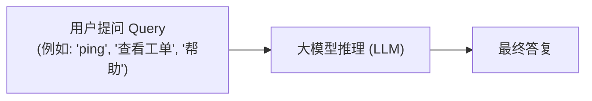
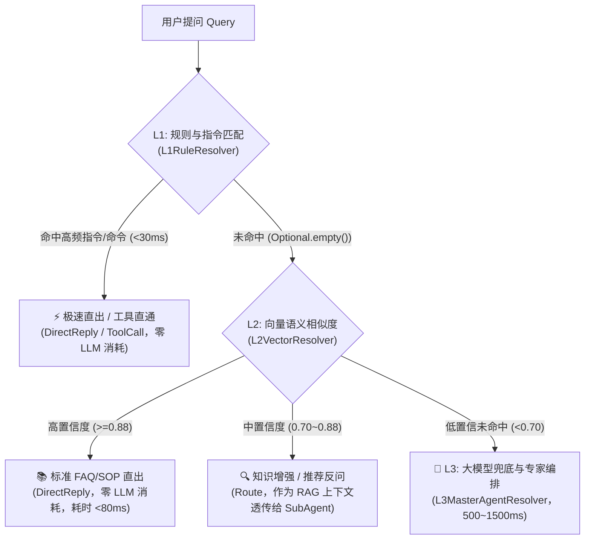
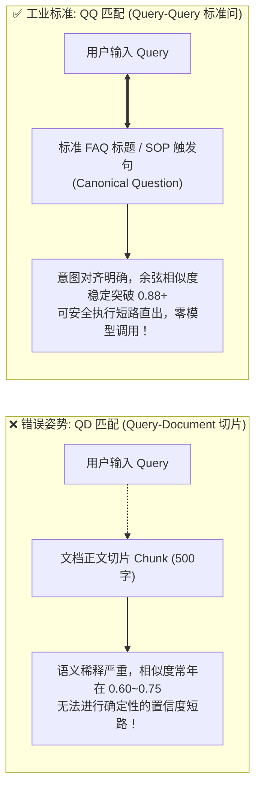
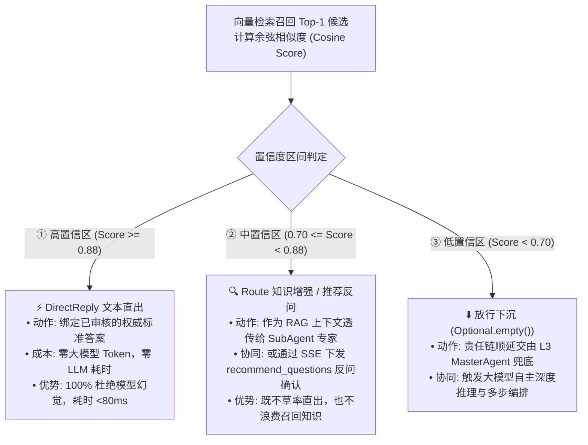
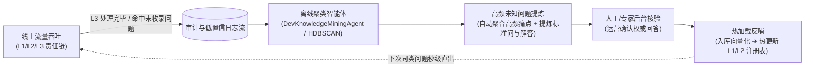

# 三级意图降级实战：为什么绝不能所有问题都直接调大模型？

> **所属专栏**：企业级 Multi-Agent 架构实战手册  
> **核心标签**：`意图识别` `成本优化` `响应时延` `三级降级` `架构权衡`

---

## 一、 新手常犯的架构误区：“万物皆调 LLM”

刚接触智能体（Agent）开发的工程师，往往会构建出这样一条极其脆弱的流水线：

在开发者本地 Demo 时，并发只有 1，几十毫秒的感知差异不明显；但**一旦系统推向企业生产环境（成百上千名员工或海量坐席在线）**，这种“单一大模型一把梭”的架构会瞬间遭遇两个灭顶之灾：
1. **时延雪崩（Latency Disaster）**：大模型首字返回（TTFT）通常在 600ms ~ 1500ms，整句吐完需要 3~5 秒。用户仅仅是想输入一个固定指令或查询状态，却不得不干瞪眼等待几秒钟的打字机。
2. **Token 账单暴涨（Token Cost Explosion）**：企业高频固定问答占到总流量的 30%~50%，每一次无意义的 LLM 调用都在真金白银地烧钱。

---

## 二、 算一笔真实的企业生产账

我们以一家拥有 **2,000 名客服/坐席** 的中型金融或电商企业为例，每天产生约 **100 万次** 咨询请求：

| 对比维度 | 全量直接调大模型 (LLM) | 引入三级意图降级体系 (L1/L2/L3) | 收益提升 |
| :--- | :--- | :--- | :--- |
| **平均请求耗时** | **1,800ms ~ 3,500ms** | **~450ms** (高频请求 <30ms 直出) | **响应提速 4~8 倍** ⚡ |
| **单日 LLM 调用量**| 1,000,000 次 | 约 550,000 次 (45% 被 L1/L2 拦截) | **大模型压力骤降 45%** |
| **单日 Token 消耗** | 约 15 亿 Tokens (含上下文Prompt) | 约 8.2 亿 Tokens | **Token 账单直接减半** 💰 |
| **极端高并发稳定性** | 易触发大模型网关 Rate Limit 限流 | 高频流量被本地内存规则消化，抗并发能力极强 | **可用性大幅提升** |

---

## 三、 架构解法：L1 ➔ L2 ➔ L3 串行降级三道防线

企业级 Agent 架构普遍推行**“分级过滤、逐层下沉”**漏斗机制：

### 1. 第一道防线：L1 规则匹配 (`L1RuleResolver`, <30ms)
- **拦截目标**：系统级硬指令（如 `/repo`、`#ping`、`/help`）、已知特定系统错误码（如 `ERR_GATEWAY_504`）、单号直查。
- **技术实现**：内存无锁快照（`AtomicReference<RuleSnapshot>`）、预编译正则、MySQL 规则表。
- **特性**：完全在应用服务本地内存完成，零网络 IO，耗时在微秒级到个位数毫秒。

### 2. 第二道防线：L2 向量匹配 (`L2VectorResolver`, <100ms)
- **拦截目标**：已有成熟标准答案的标准化 FAQ、业务排障 SOP（如“如何申请配置权限”、“年假结算标准”、“504网关超时排障流程”）。
- **技术实现**：计算 Query 向量，在向量数据库中进行余弦相似度检索。
- **特性**：语义泛化能力强，采用**双阈值漏斗模型**，高置信度时直接短路直出，杜绝模型幻觉与 Token 浪费。

### 3. 第三道防线：L3 大模型兜底与专家编排 (`L3MasterAgentResolver`, 500~1500ms)
- **拦截目标**：模糊口语化描述、多轮复杂诉求（既要查日志又要排查慢查）、全新未见过的疑难故障。
- **技术实现**：调用大模型进行意图分类、深层语义推理与多专家任务编排（`MasterAgentRouter`）。

---

## 四、 深入 L2 向量层：匹配机制、双阈值分流与 RAG 边界

在实际架构评审与落地中，关于 L2 经常会引发三大核心疑问：**“向量到底匹配什么？”、“召回后靠相似度直出还是再给大模型？”、“L2 和业务 RAG 的边界是什么？”**

### 1. L2 向量到底匹配什么？—— QQ 匹配 vs QD 匹配

很多开发者初次接触向量检索时，习惯按照传统文档 RAG 思路：把数十页的运维手册、API 文档按 500 字切片（Chunk）丢进向量库，让用户的 Query 去检索文档切片。

> ⚠️ **核心架构避坑：L2 意图网关绝不能使用长文档切片（QD 匹配）！**

- **QD 匹配（Query-to-Document）**：用户问“504 怎么看”，文档切片包含了大量架构图、背景原理、配置参数等正文。两者的向量余弦相似度通常只有 0.60 ~ 0.75，**无法设定一个清晰的切分阈值**，若直接直出极易“答非所问”。
- **QQ 匹配（Query-to-Query）**：L2 向量库中只索引**“标准问题（Standard/Canonical Question）”**及其同义扩展句。当用户输入“网关报504怎么排查”与标准库中的“504网关超时排障步骤”计算余弦相似度时，因语义高度对齐，相似度能稳定达到 0.88 甚至 0.95 以上。

### 2. 召回后靠 Top 相似度还是给大模型？—— 双阈值分流引擎

**核心原则：能不调大模型，就绝不调大模型！**

L2 绝不仅仅是一个召回检索器，而是一个**基于置信度双阈值（Dual-Threshold）的分流决策器**：

1. **高置信度（Score $\ge 0.88$）➔ 彻底短路直出 (`Resolution.DirectReply`)**：
   - 证明用户意图与标准知识库高度吻合。系统直接将知识库中由人工/运营团队严格审核过的标准答案下发；
   - **绝对不调大模型**：大模型二次润色不仅会平白增加 1~3 秒的时延和数百 Token 开销，还可能引入“自由发挥”的幻觉风险。
2. **中置信度（$0.70 \le \text{Score} < 0.88$）➔ 知识增强或反问确认 (`Resolution.Route`)**：
   - 用户提问与已知知识相近，但存在修饰词差异或潜在多意图。此时不能直接下结论；
   - **召回内容作为上下文上浮给模型**：把召回的候选 FAQ 挂载在 `AgentContext.attributes` 中，路由给业务专家（`SubAgent`），让大模型在受控上下文中作答，或者在前端渲染推荐提问气泡（“您是否想查询：504超时应急处置流程？”）。
3. **低置信度（Score $< 0.70$）➔ 责任链平滑放行 (`Optional.empty()`)**：
   - 视为本层未命中，无缝下沉至 L3。

### 3. L2 意图网关 vs SubAgent 业务 RAG 的边界划分

很多人容易混淆“流水线上的 L2”与“智能体内部的 RAG”，两者的定位与职责是完全正交的：

| 架构维度 | **L2 向量意图网关 (`L2VectorResolver`)** | **SubAgent 业务知识 RAG (Agent-level RAG)** |
| :--- | :--- | :--- |
| **所处生命周期** | **流水线解析前置门禁**（意图研判阶段） | **业务专家执行阶段**（任务执行阶段） |
| **核心定位** | **“截流器 / 减压阀”**（跳过大模型） | **“专家外脑 / 知识库工具”**（辅助大模型） |
| **检索对象** | 标准问句、FAQ 标题、SOP 触发条件（QQ 匹配） | 业务长篇技术文档、API 手册、代码仓库、日志文档（QD 匹配） |
| **最终产出物** | 统一意图决议（`DirectReply` 或 `Route`） | 注入 Prompt 的专业背景上下文（Context） |
| **对 LLM 的态度** | **能不用大模型就绝不用大模型** | **必须依赖大模型进行综合理解与总结推导** |

### 4. L1、L2、L3 全维度边界对照矩阵

| 对比维度 | **L1 规则匹配 (`L1RuleResolver`)** | **L2 向量知识库 (`L2VectorResolver`)** | **L3 大模型协调器 (`L3MasterAgentResolver`)** |
| :--- | :--- | :--- | :--- |
| **责任链顺序** | `@Order(100)` 最高优先级 | `@Order(200)` 次席语义过滤 | `@Order(300)` 最终兜底中枢 |
| **定位场景** | 系统硬指令、精准快捷命令、确定性错误码 | 标准化 FAQ、业务排障 SOP、规范制度 | 开放语义、模糊口语、多轮会话、跨领域复合故障 |
| **输入特征** | 精准匹配、固定前缀、带参数正则 | 自然语言口语提问，但属于**已有收录的标准问法** | 复杂描述（如：“昨天灰度后订单服务老报 504，帮我看看并止血”） |
| **底层技术** | 内存无锁快照、预编译正则、MySQL 规则表 | Embedding 向量化、余弦相似度、双阈值判定 | Spring AI `ChatClient`、Prompt 工程、ReAct 自主循环 |
| **时延指标** | **< 30ms**（纯内存比对常态 < 1ms） | **< 100ms**（仅向量化与索引比对） | **500ms ~ 1500ms+**（大模型生成与多步推理） |
| **Token 成本** | **0 Token** | **0 生成 Token**（仅 Embedding 计费，微量） | **全量消耗**（Prompt + Completion Tokens） |
| **产出决议形态** | • `DirectReply`（静态文本直出） • `ToolCall`（精准反射直调 `@Tool`） | • 高置信：`DirectReply`（FAQ 标准答案） • 中置信：`Route`（带知识上浮给模型） • 未达阈值：放行至下一级 | • `Route`（`SINGLE` 单专家、`COMPOSITE` 复合协同、`FALLBACK` 通用兜底） |
| **是否调用大模型**| **绝对不调** | **高置信命中绝对不调**（仅中置信作为知识传递） | **必须调用**（驱动专家推理、流式回传、装配卡片） |

---

## 五、 数据飞轮：L2 知识库的冷启动与自进化闭环

系统刚上线时，L2 向量库的数据从何而来？随着业务运行，L2 如何动态生长？

1. **冷启动**：由业务团队初期导入 50~100 个核心高频问题与官方标准解答；
2. **线上采集**：通过 Hooks 机制将所有下沉到 L3 处理的未命中请求或低置信请求记入审计流；
3. **离线聚类**：离线挖掘智能体（`DevKnowledgeMiningAgent`）利用文本聚类算法（如 HDBSCAN），将高频出现的相似诉求自动合并；
4. **人工审核入库**：生成待确认 FAQ 草稿，人工确认标准解答后一键发布；
5. **反哺进阶**：向量库热更新完成，下一次相同语义提问将直接被 L2 在 80ms 内拦截直出。大模型调用量随时间推移持续下降，系统越用越快、越用越省！

---

## 六、 核心架构总结

三级意图降级不是“省去大模型”，而是**“把大模型用在刀刃上”**。

- **L1** 让确定性的前缀指令与系统命令走 **微秒级内存通道**；
- **L2** 让标准化的高频 FAQ 与业务 SOP 走 **双阈值向量拦截通道**；
- **L3** 把宝贵的模型算力留给真正的 **复杂语义理解与深层排障协同**。

这是每一个工业级 Multi-Agent 系统走向大规模企业级生产必须筑牢的防线。

---

> 💡 **工程落地指引**：关于如何基于 Spring 责任链与 Java 21 `sealed interface` 在流水线中消除硬编码分支、落地 `IntentResolver` 与 L2 预留插槽，请继续阅读实战篇：  
> 📘 **[10. 拒绝 Pipeline 硬编码：基于 Spring 责任链实现可插拔 IntentResolver 与 L2 预留插槽](./10-拒绝Pipeline硬编码：基于Spring责任链实现可插拔IntentResolver与L2预留插槽.md)**
