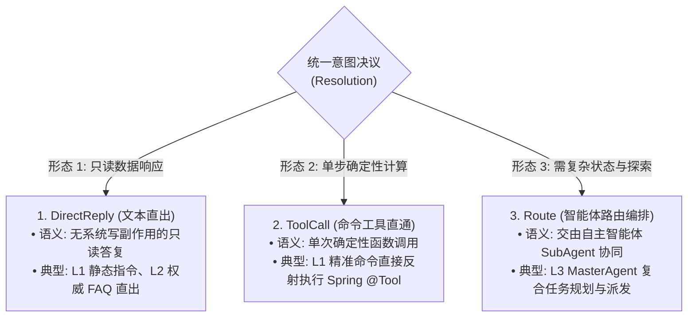
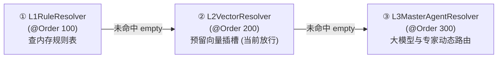

# 拒绝 Pipeline 硬编码：基于 Spring 责任链实现可插拔 IntentResolver 与 L2 预留插槽

> **所属专栏**：企业级 Multi-Agent 架构实战手册  
> **核心标签**：`架构重构` `责任链模式` `Java 21 Sealed Classes` `三级意图降级` `微内核SPI`

---

## 一、 生产坏味道：流水线里的“两段式硬编码”

在智能体流水线演进初期，为了快速跑通最小可行性原型（MVP），很多系统会写出如下代码：

```java
// ❌ 典型的硬编码分流流水线 (Anti-pattern)
IntentMatchResult l1Result = l1RuleMatcher.match(query);
if (l1Result.isMatched()) {
    if ("STATIC_TEXT".equalsIgnoreCase(l1Result.getTargetType())) {
        // 静态指令直出
        streamText(context, l1Result.getDirectReply());
        return;
    } else if ("TOOL".equalsIgnoreCase(l1Result.getTargetType())) {
        // 工具调度直出
        String toolResult = l1ToolDispatcher.dispatch(l1Result.getTargetRef(), ...);
        streamText(context, toolResult);
        return;
    }
}

// 绕过 L2，直接跳进 MasterAgent 路由
DispatchPlan plan = masterAgentRouter.route(query);
// 派发 SubAgent 业务专家...
```

### 这种实现存在三大架构缺陷：
1. **违背开闭原则（OCP）**：流水线（Pipeline）强耦合了具体的意图判断类（`L1RuleMatcher`、`MasterAgentRouter`）。如果我们要加入 L2 向量检索，或者增加安全合规前置拦截，就必须不断入侵修改 `AgentPipelineServiceImpl` 的核心代码；
2. **决议协议割裂**：L1 输出的是 `IntentMatchResult`，而 MasterAgent 输出的是 `DispatchPlan`，数据结构完全不同，流水线内部充斥着大量脆弱的粘合胶水代码；
3. **无法平滑灰度与演进**：各层级无法通过 Spring 的 `@Order` 动态插拔或调整优先级。

---

## 二、 架构推导：统一意图决议（Resolution）为什么只有这三种？

任何自然语言意图，经过系统识别与研判后，在计算机控制流层面最终要执行的动作**只有三种物理形态**，不多也不少：



> 💡 **架构避坑说明**：为什么决议中没有 `CardResolution`？  
> 意图解析的职责是**“研判用户要做什么”**，而不是**“执行业务”**。交互卡片（如紧急止血操作卡片、Issue 提交卡片）是业务专家（`SubAgent`）在排障推理后根据上下文动态决策生成的，它属于业务执行期的产物，绝不能过早污染意图解析层的纯净性。

---

## 三、 统一契约建模：Java 21 密封接口与 SPI 设计

### 1. 决议契约：`Resolution`
借助 Java 21 的 `sealed interface`（密封接口）和 `record`，我们可以获得强类型的编译期安全与不可变数据载体：

```java
package com.example.springai.core.routing;

import com.example.springai.core.routing.dto.PlanType;
import java.util.List;
import java.util.Map;

/**
 * 意图解析执行决议 (统一抽象三种标准输出)
 */
public sealed interface Resolution {
    /** 产出该决议的层级标识: "L1", "L2", "L3" */
    String level();

    /** 1. 文本直出 (L1 静态文本、L2 高置信 FAQ) */
    record DirectReply(String level, String ruleCode, String text) implements Resolution {}

    /** 2. 工具直通 (L1 确定性 Tool 调用) */
    record ToolCall(String level, String ruleCode, String toolRef, 
                    String paramTemplate, Map<String, Object> extractedParams) implements Resolution {}

    /** 3. 智能体路由 (单专家直通、多专家复合编排、兜底) */
    record Route(String level, PlanType planType, List<RouteStep> steps, String reason) implements Resolution {}

    record RouteStep(int stepOrder, String targetAgent, String taskDesc, Map<String, Object> contextParams) {}
}
```

### 2. 意图解析器 SPI：`IntentResolver`
通过实现 Spring 的 `Ordered` 接口，定义责任链的标准规范：

```java
package com.example.springai.core.routing;

import com.example.springai.core.context.AgentContext;
import org.springframework.core.Ordered;
import java.util.Optional;

/**
 * 意图解析器统一抽象，按 Ordered 串行执行降级
 */
public interface IntentResolver extends Ordered {
    /** 标识所属层级: "L1" / "L2" / "L3" */
    String level();

    /**
     * 解析意图
     * @return 命中返回决议 Optional.of(Resolution)；未命中返回 Optional.empty()，自动下沉到下一层
     */
    Optional<Resolution> resolve(AgentContext context);
}
```

---

## 四、 三层解析器落地演进



### 1. 第一关：L1 规则适配器 (`L1RuleResolver`, Order = 100)
无缝复用底层现有的 `L1RuleMatcher`，将其匹配结论封装转换为标准 `Resolution`：
- 若命中 `STATIC_TEXT` $\to$ 转换为 `Resolution.DirectReply`；
- 若命中 `TOOL` $\to$ 转换为 `Resolution.ToolCall`；
- 若未命中 $\to$ 返回 `Optional.empty()`，毫秒级平滑放行至 L2！

### 2. 第二关：L2 向量预留插槽 (`L2VectorResolver`, Order = 200)
这是本次重构的核心战略点——**通过空插槽为未来 M5 向量知识库就绪预留位置**：
```java
@Component
@Slf4j
public class L2VectorResolver implements IntentResolver {
    @Override
    public int getOrder() { return 200; }

    @Override
    public String level() { return "L2"; }

    @Override
    public Optional<Resolution> resolve(AgentContext context) {
        // 当前阶段向量知识库尚未挂载，输出调试日志并放行
        log.debug("[L2VectorResolver] 向量知识库暂未挂载，放行至下一级");
        return Optional.empty();
    }
}
```
未来接入 VectorStore 时，**流水线和外部所有调用方的代码完全不需要改动任何一行**！届时只需填充 `L2VectorResolver` 的双阈值判定即可：

```java
// 📐 未来 M5 接入 VectorStore 时的双阈值判定代码骨架
VectorMatchCandidate topMatch = vectorStore.searchTop1(queryEmbedding);
if (topMatch != null && topMatch.getScore() >= 0.88) {
    // 1. 高置信度 (>=0.88): 标准 FAQ/SOP 答案短路直出，零 LLM 消耗
    return Optional.of(Resolution.directReply("L2", topMatch.getFaqCode(), topMatch.getStandardAnswer()));
} else if (topMatch != null && topMatch.getScore() >= 0.70) {
    // 2. 中置信度 (0.70~0.88): 挂载检索上下文，路由至领域专家作答或生成推荐反问
    context.getAttributes().put("L2_RAG_CONTEXT", topMatch.getStandardAnswer());
    return Optional.of(Resolution.route("L2", PlanType.SINGLE, List.of(
            new DispatchStep(1, topMatch.getTargetAgentCode(), "参考已知知识解答: " + topMatch.getQuestion(), Map.of())
    ), "命中中置信度相似知识"));
}
// 3. 低置信度 (<0.70): 放行下沉至 L3 专家路由
return Optional.empty();
```
### 3. 第三关：L3 专家路由适配器 (`L3MasterAgentResolver`, Order = 300)
将 `MasterAgentRouter` 封装为责任链的最后一道防线。调用现有动态意图路由算法，将产出的 `DispatchPlan` 转换为 `Resolution.Route`，支持单意图直通（SINGLE）、复合多专家协同（COMPOSITE）与通用兜底（FALLBACK）。

---

## 五、 极简流水线重构：责任链与模式匹配

完成 SPI 抽象后，`AgentPipelineServiceImpl` 的核心代码缩减并收敛为极致优雅的形式：

```java
@Service
@RequiredArgsConstructor
public class AgentPipelineServiceImpl implements AgentPipelineService {

    // Spring 会自动按照 @Order 注入排序好的责任链: L1(100) -> L2(200) -> L3(300)
    private final List<IntentResolver> intentResolvers;
    private final L1ToolDispatcher l1ToolDispatcher;
    private final List<SubAgent> subAgents;
    private final GeneralChatAgent defaultGeneralAgent;

    public void process(ChatRequest request) {
        AgentContext context = buildContext(request);

        CompletableFuture.runAsync(() -> {
            // 1. 遍历意图解析责任链，逐层串行降级
            Resolution resolution = null;
            for (IntentResolver resolver : intentResolvers) {
                Optional<Resolution> opt = resolver.resolve(context);
                if (opt.isPresent()) {
                    resolution = opt.get();
                    log.info("[Pipeline] 意图解析命中层级: {}, 决议: {}", resolver.level(), resolution.getClass().getSimpleName());
                    break;
                }
            }

            // 2. 根据统一决议协议，执行对应动作
            if (resolution instanceof Resolution.DirectReply direct) {
                context.getSink().progress("DIRECT_REPLY", "命中快捷指令/标准答案，极速直出");
                streamText(context, direct.text());
                context.getSink().done();
            } else if (resolution instanceof Resolution.ToolCall tool) {
                context.getSink().progress("TOOL_DISPATCH", "命中命令直通，调度工具: " + tool.toolRef());
                String result = l1ToolDispatcher.dispatch(tool.toolRef(), tool.extractedParams());
                streamText(context, result);
                context.getSink().done();
            } else if (resolution instanceof Resolution.Route route) {
                dispatchAgents(context, route);
                context.getSink().done();
            }
        }, pipelineExecutor);
    }
}
```

---

## 六、 架构重构收益

1. **流水线彻底脱敏**：Pipeline 不再关心底层匹配是正则、SQL、还是大模型，实现了真正的微内核调度；
2. **具备平滑演进能力**：未来上线 L2 向量检索时，直接实现 `L2VectorResolver` 即可，零修改 Pipeline，零回归风险；
3. **协议纯净统一**：三种 Resolution 覆盖全场景，彻底消除胶水代码与类型强转。
