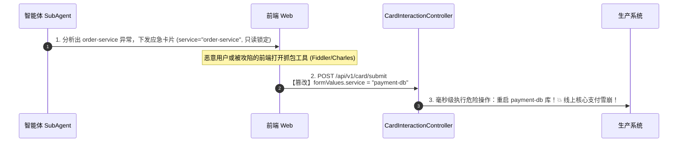
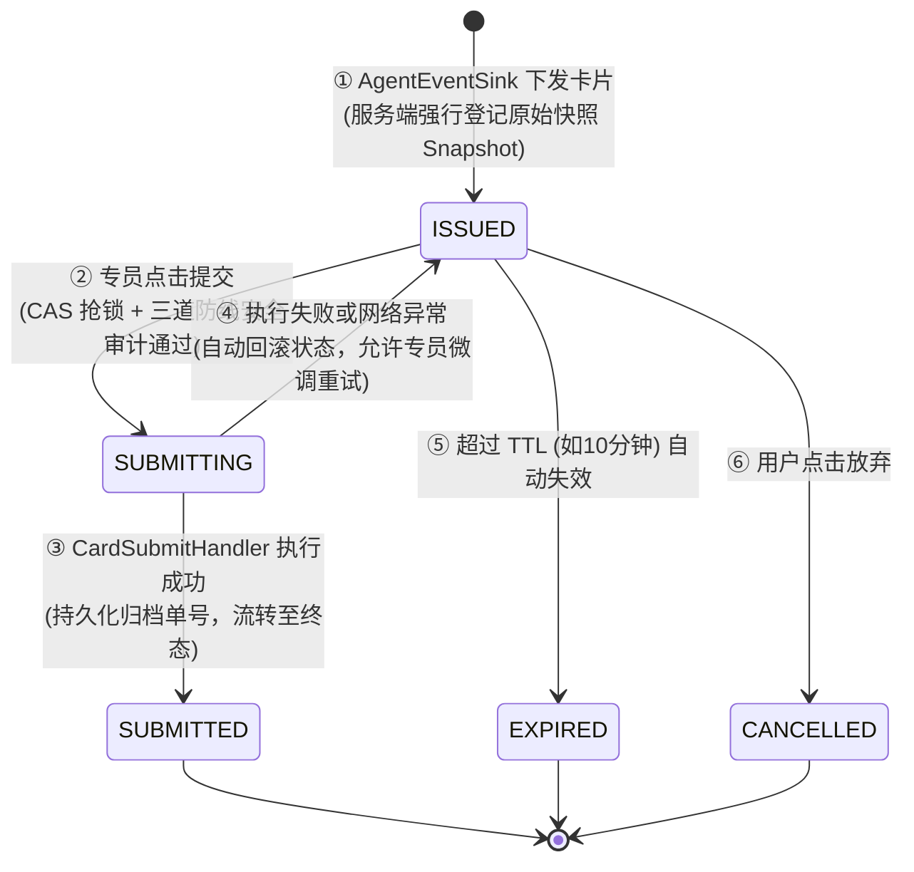
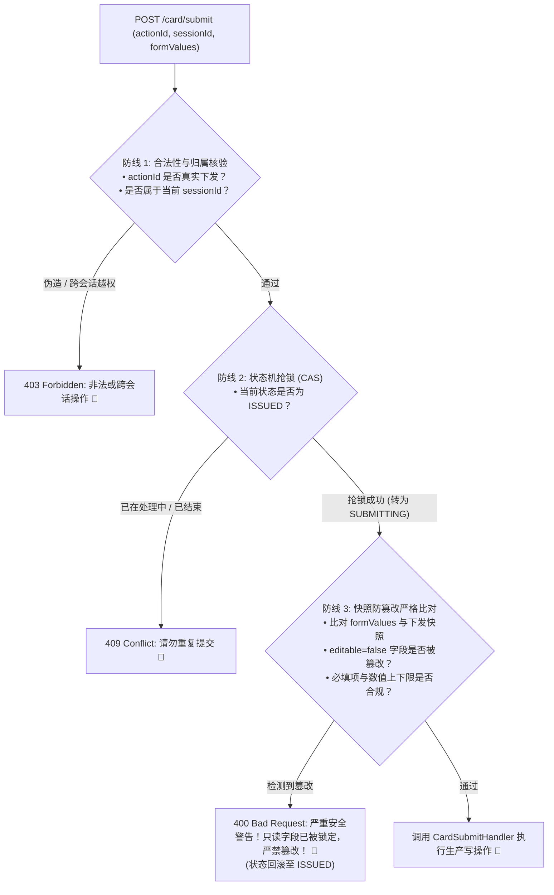

# Human-in-the-loop 进阶：如何基于 CardRegistry 状态机实现只读字段防篡改与越权拦截

> **所属专栏**：企业级 Multi-Agent 架构实战手册  
> **核心标签**：`Human-in-the-loop` `状态机` `防篡改审计` `接口安全` `CardRegistry`

---

## 一、 生产车祸现场：为什么光有交互卡片还远远不够？

在手册第 03 篇中，我们确立了一条铁律：**“绝不能让大模型直接拥有生产系统的写权限，必须经由交互卡片（InteractiveCard）由人工确认（Human-in-the-loop）后提交。”**

许多团队在做完卡片后，往往会设计出如下非常天真的交互控制器：



### 暴露出的三大致命安全漏洞：
1. **只读字段篡改漏洞（Parameter Tampering）**：前端展示时 `editable=false` 只是把输入框锁灰，攻击者直接调用 HTTP 接口篡改参数，后端如果直接信任传入的 `formValues`，只读限制直接形同虚设；
2. **伪造 ActionId 越权（ActionId Forgery）**：后端缺乏下发登记，任意构造一个随机 UUID 就可以当做合法卡片骗过系统；
3. **跨会话冒充（Session Hijacking）**：A 用户的卡片被 B 用户拿去提交，后端没有校验卡片归属的 `sessionId`。

---

## 二、 架构解法：服务端卡片注册表与状态机模型

要彻底防御上述漏洞，**卡片的生命周期与状态必须完全收口在服务端**。前端只有“展示”和“收集输入”的职责，没有任何决定权。



### 卡片状态机枚举 (`CardState`)：
- **`ISSUED`（已签发）**：智能体诊断出方案并登记了原始字段快照（Snapshot），等待专员处理；
- **`SUBMITTING`（提交中）**：专员点击确认，状态通过原子 CAS 跃迁，**阻断高并发下的连击与重复提交**；
- **`SUBMITTED`（已完成）**：系统底层 SPI 执行成功并关联了正式工单号，永久锁定归档；
- **`FAILED`（失败）**：执行异常，可退回 `ISSUED` 允许重试，或转为 `FAILED`；
- **`EXPIRED`（已过期）**：运维止血类卡片具有极强的时效性，超过设定的 TTL（例如 10 分钟）未处理则自动失效，杜绝“拿三小时前的预案在当前故障执行”。

---

## 三、 核心实现：三道防线防篡改审计

当请求进入 `/api/v1/card/submit` 时，`CardRegistry` 必须强制执行三道防御审计：



### 1. 防篡改比对核心算法（Java 21 实现）
```java
public void validate(CardRecord record, Map<String, Object> submittedValues) {
    InteractiveCard snapshot = record.getSnapshot();
    if (snapshot == null || snapshot.getFields() == null) {
        return;
    }

    for (CardFormField field : snapshot.getFields()) {
        String key = field.getFieldKey();
        Object originalVal = field.getValue();
        Object submittedVal = submittedValues != null ? submittedValues.get(key) : null;

        // 🚨 核心防线：只读字段防篡改核验
        if (!field.isEditable()) {
            if (!Objects.equals(String.valueOf(originalVal), String.valueOf(submittedVal))) {
                log.error("[CardSecurity] 🚨 检测到只读字段恶意篡改！actionId={}, field={}, original={}, submitted={}",
                        record.getActionId(), key, originalVal, submittedVal);
                throw new SecurityException("安全警告：只读参数 [" + field.getLabel() + " (" + key + ")] 被系统锁定，严禁篡改！");
            }
        }

        // 必填项核验
        if (field.isRequired() && (submittedVal == null || !StringUtils.hasText(String.valueOf(submittedVal)))) {
            throw new IllegalArgumentException("必填字段 [" + field.getLabel() + "] 不能为空");
        }

        // 数值范围核验 (minLimit / maxLimit)
        validateLimits(field, submittedVal);
    }
}
```

---

## 四、 全链路闭环：下发登记与提交审计

### 1. 产生时：`AgentEventSink.card()` 自动登记快照
在智能体输出卡片事件时，不是直接发往前端，而是**先在 `CardRegistry` 中留存快照，再推流给客户端**：

```java
@Override
public boolean card(InteractiveCard card) {
    if (card != null && cardRegistry != null) {
        // 1. 服务端强制留存快照
        cardRegistry.register(sessionId, card);
    }
    // 2. 推流给前端
    return publisher.sendInteractiveCard(sessionId, card);
}
```

### 2. 提交时：控制器完全基于状态机调度
```java
@PostMapping("/submit")
public ResponseEntity<?> submitCard(@RequestBody CardSubmitRequest request) {
    // 1. 申领卡片 + 抢锁 (ISSUED -> SUBMITTING) + 归属校验
    CardRecord record = cardRegistry.claim(request.getActionId(), request.getSessionId());

    try {
        // 2. 字段只读防篡改审计
        cardRegistry.validate(record, request.getFormValues());

        // 3. 执行业务 Handler (如 SRE 止血)
        CardSubmitResult result = matchedHandler.handleSubmit(request);

        // 4. 成功流转为 SUBMITTED 终态
        cardRegistry.complete(request.getActionId(), result);
        return ResponseEntity.ok(result);

    } catch (SecurityException | IllegalArgumentException ex) {
        // 校验失败或被攻击，释放回 ISSUED 并记录审计告警
        cardRegistry.fail(request.getActionId(), ex.getMessage());
        return ResponseEntity.badRequest().body(Map.of("code", 400, "message", ex.getMessage()));
    } catch (Exception ex) {
        // 运行时异常允许专员重试
        cardRegistry.fail(request.getActionId(), "系统执行异常: " + ex.getMessage());
        return ResponseEntity.internalServerError().body(Map.of("code", 500, "message", "系统执行异常"));
    }
}
```

---

## 五、 总结与生产收益

1. **筑牢人机协同最后 100 米的安全底线**：即使前端被反编译、参数被抓包，**凡是智能体认定的安全约束（`editable=false`），服务端 100% 无法被绕过**；
2. **彻底消灭重复提交与竞态条件**：借助原子状态机替代简陋的内存时间戳缓存，状态流转精准且可追溯；
3. **审计与故障复盘有据可依**：下发的原始快照与最终提交值完全记录在 `CardRecord` 中，任何误操作或异常变更均有完整的取证链条。
