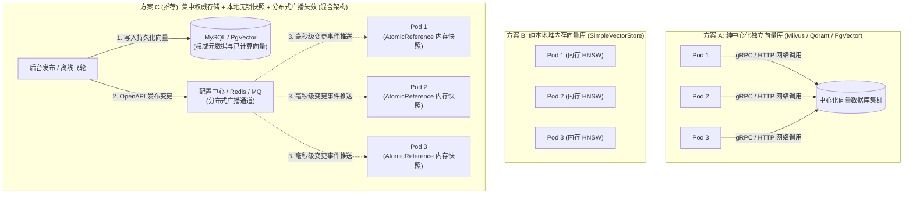
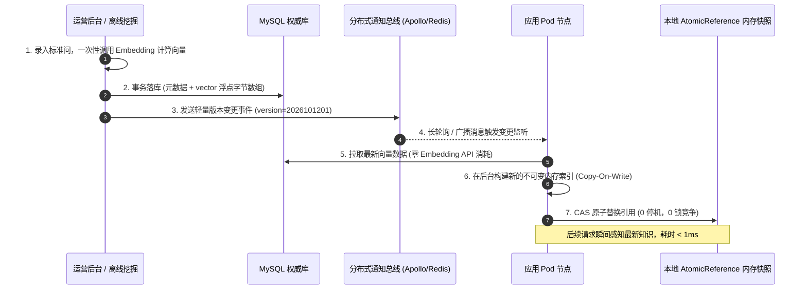
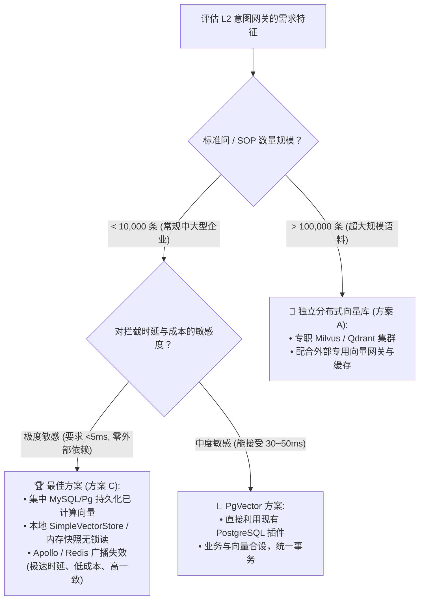

# 分布式环境下 L2 向量检索如何选型与集群同步？——极速时延与强一致性的架构权衡

> **所属专栏**：企业级 Multi-Agent 架构实战手册  
> **核心标签**：`向量数据库选型` `分布式集群同步` `本地内存索引` `双阈值网关` `一致性与时延`

---

## 一、 为什么 L2 的选型不能直接照搬传统 RAG？

在智能体流水线设计中，很多团队一旦听到“向量检索”，第一反应就是立刻申请服务器、搭建 Milvus、Qdrant 集群，或者在 PostgreSQL 上挂载 `pgvector`。

然而，**L2 意图拦截网关与传统知识库 RAG 在核心指标上存在根本性的差异**：

| 对比维度 | **L2 意图网关层 (`L2VectorResolver`)** | **传统长文档 RAG / 知识库系统** |
| :--- | :--- | :--- |
| **首要核心目标** | **极速分流拦截**（高置信直接短路跳过 LLM） | **知识外脑扩充**（为 LLM 提供长上下文背景） |
| **P99 时延要求** | **< 100ms**（留给检索的时间通常要求 **< 10ms**） | **1,000ms ~ 3,000ms**（主要是 LLM 总结耗时） |
| **检索载体规模** | **小而精**：几百到数千条标准问（QQ 匹配） | **大而全**：数十万到上千万切片（QD 匹配） |
| **读写倾斜度** | **极致高频只读**（读吞吐极高，写入为低频运营操作） | **中低频读、频繁增量导入/切片** |
| **网络 RTT 敏感度** | **极度敏感**（多一次跨机房 RPC 就消耗 20~50ms） | **相对不敏感**（被后续 LLM 的数秒耗时所掩盖） |

这就带来了一个残酷的现实：
如果直接采用传统的独立集中式向量数据库，每次用户输入都需要经历：
$$\text{Query 向量化} \longrightarrow \text{网络 RPC 调用远程向量库} \longrightarrow \text{序列化/反序列化} \longrightarrow \text{结果回传}$$
仅网络往返与远程协议开销就经常吃掉 30ms ~ 80ms，留给整个系统的缓冲极其微弱。

但反过来，如果全部放在每个应用 Pod 的本地堆内存中，在多 Pod 分布式部署时又会面临致命挑战：**运营人员在后台新增或修改了一条排障 SOP，如何确保几十个 Pod 在毫秒级内同步刷新？如何防止 Pod 之间数据不一致导致的“同问不同答”？**

---

## 二、 三大主流选型方案深度横评

面对“极致低时延”与“分布式一致性”的双重挑战，业界通常有三种架构演进路径：



### 1. 方案 A：纯中心化独立向量库（如 Milvus / Qdrant）
* **原理**：应用 Pod 完全无状态，检索全量委托给远程独立集群。
* **优势**：天然的一致性；水平扩展容易，支撑上亿向量。
* **致命痛点**：
  * **杀鸡用牛刀**：几千条 FAQ 的意图识别，却要引入一套依赖 etcd / MinIO / Pulsar 的庞大中间件集群，运维负担与硬件成本极高；
  * **网络 IO 拖累时延**：在高并发大流量下，网络抖动极易导致 L2 意图识别超时，甚至直接击穿到 L3 大模型。

### 2. 方案 B：纯本地堆内存向量库（In-Memory Store）
* **原理**：每个应用节点启动时构建内存索引（如 Spring AI 的 `SimpleVectorStore`），完全在 JVM 堆内做余弦相似度计算。
* **优势**：
  * **极速响应（< 5ms）**：纯堆内内存无锁比对，零网络 IO，完全不受远程网络抖动影响；
  * **零额外基础设施**：不需要引入任何新中间件，开箱即用。
* **致命痛点**：分布式脑裂。各 Pod 独立运行，无法动态感知运营后台的增删改，且每次重启都要重新向量化，开销巨大。

### 3. 方案 C（工业级最佳解）：集中权威存储 + 本地无锁快照 + 事件广播同步
* **设计哲学**：**“读走本地内存，写走集中持久化，中间靠轻量事件广播拉齐”**。
* **落地逻辑**：
  1. **权威数据集中存储**：标准问元数据与预先算好的 Embedding 向量统一保存在 MySQL（MediumBlob）或 PostgreSQL 中，作为唯一事实来源（Single Source of Truth）；
  2. **数据面全内存无锁读**：每个应用节点通过 `AtomicReference` 持有只读的内存向量索引快照，对外提供微秒至毫秒级的检索；
  3. **控制面广播同步**：当规则发布或更新时，管理端通过分布式广播（Apollo / Nacos / Redis Pub-Sub）下发轻量通知，各 Pod 增量/全量刷新本地快照。

---

## 三、 分布式环境下集群同步的 4 种机制与决策

在确定方案 C 的混合模式后，核心技术命题变为：**“控制面的更新，如何又快又稳地推送到数十个 Pod？”**



### 1. 机制一：定时轮询拉取（Pull-based Scheduled Refresh）
* **做法**：每个 Pod 每隔 $N$ 分钟查一次 DB 的最大更新时间戳，有变动则拉取。
* **评价**：❌ **不推荐作为主通道**。存在长达 $N$ 分钟的数据不一致窗口，若频繁拉取又会对 DB 产生空轮询压力。

### 2. 机制二：Redis Pub/Sub 广播通知（Push-based Invalidation）
* **做法**：发布新 FAQ 后，向 Redis 的 `AGENT_L2_SYNC_CHANNEL` 发布广播事件，各节点监听并热重载。
* **评价**：⚡ **速度极快（<20ms）**。但 Redis Pub/Sub 是“发后即忘”协议，若某个 Pod 刚好在重启或发生短暂网络抖动，会彻底丢失此通知。需要搭配“启动预热 + 定时版本比对”作为双保险。

### 3. 机制三：配置中心长轮询广播（基于 Apollo / Nacos）—— **本项目首选 ⭐**
* **做法**：
  * 管理后台保存 MySQL 后，通过 Apollo / Nacos 的 OpenAPI 修改全局配置键 `agent.l2.version`；
  * 各 Pod 借助配置中心成熟的 HTTP 长轮询机制，在毫秒级内收到变更推送；
  * 触发 Spring 内部事件，完成快照重载。
* **为什么首选它？**
  1. **零新增组件**：复用项目现有的 Apollo 集群同步基础设施（与 [`L1ApolloRuleListener`](file:///d:/projects/ai-demo/src/main/java/com/example/springai/infra/sync/listener/L1ApolloRuleListener.java) 设计哲学完全统一）；
  2. **天生具备可靠保底**：配置中心拥有极其完备的断网重连、长轮询兜底与本地缓存容灾机制，绝无丢消息风险。

---

## 四、 向量检索的分布式工程避坑指南

### 1. 核心避坑：千万不要在每个 Pod 本地计算 Embedding！
这是许多工程师最容易犯的低级错误：
> ❌ **错误实现**：后台只保存了文本问题，通知 50 个 Pod 刷新；50 个 Pod 分别调用 OpenAI 或大模型 Embedding 接口对这批文本进行向量化计算。

* **后果**：
  1. **成本暴涨 50 倍**：一次简单的 FAQ 变更，导致几十个节点并发调用外部商业 Embedding API；
  2. **触发 Rate Limit 限流**：并发几十次 Embedding 请求容易击穿供应商的每分钟请求配额（RPM/TPM），导致部分 Pod 刷新失败、集群数据永久不一致；
  3. **刷新期间 CPU 飙升**：密集浮点计算影响主通信链路。

* **✅ 正确做法：“单点计算，全员共享”**：
  * 在管理端审核入库时，由管理端调用 **一次** Embedding API，将计算好的浮点数数组（如 `float[1536]`）直接序列化（二进制 Blob 或 JSON）存入 MySQL；
  * 广播同步时，各 Pod 只需要把字节数组反序列化回内存，**零 API 调用、零外部 Token 成本、百毫秒内瞬间加载完成！**

### 2. 版本对齐防线：Embedding 模型的“空间对齐锁”
向量检索的前提是：**用户的 Query 与候选标准问必须位于“同一个向量空间”中**。
如果后台历史数据是用 `text-embedding-3-small` 生成的，而后来某次升级把全局模型换成了百炼的 `text-embedding-v3`，余弦相似度计算将彻底失真，导致全部误判下沉到 L3！

* **防线设计**：
  在权威库中记录每批向量的 `model_name` 和 `dimension`（例如 `text-embedding-3-small:1536`）。应用启动时若检测到本地运行态模型与库中向量模型不匹配，直接告警并拒绝加载，严防隐蔽的数据污染。

### 3. 内存读写分离：基于 Copy-On-Write 彻底消除读写锁
在每秒数千 QPS 的数据面上，向量检索绝不能加 `synchronized` 或读写锁。
应直接采用 Java 并发的 **Copy-On-Write 原则** 与 `AtomicReference`：

```java
public class L2VectorRegistry {
    // 内存只读快照容器
    private final AtomicReference<VectorSnapshot> activeSnapshotHolder = 
            new AtomicReference<>(VectorSnapshot.empty());

    // 读链路：直接从快照读取，零锁零阻塞
    public Optional<L2MatchResult> search(float[] queryEmbedding, double threshold) {
        return activeSnapshotHolder.get().search(queryEmbedding, threshold);
    }

    // 写链路：收到广播后，在后台构建新快照，原子替换
    public synchronized void reload(List<FaqEntity> entities) {
        VectorSnapshot newSnapshot = VectorSnapshot.build(entities);
        activeSnapshotHolder.set(newSnapshot); // 原子 CAS 替换
        log.info("[L2VectorRegistry] 向量快照已热重载，当前生效标准问数: {}", entities.size());
    }
}
```

---

## 五、 技术选型决策树

对于企业 Multi-Agent 系统中的 L2 向量层，可参照如下决策树进行架构定型：



---

## 六、 总结

L2 向量检索层是企业 Multi-Agent 架构中**“最追求时延性价比”**的一环。

1. **选型不跟风**：不要为了用向量库而用向量库。在千级意图语料下，**“集中存储权威数据 + 本地内存无锁快照”** 是兼具性能（<5ms）与成本（0 额外服务器）的最优解；
2. **同步靠事件**：依托现存成熟的配置中心（Apollo）或分布式总线，通过版本号长轮询与 Copy-On-Write 原子替换，实现秒级全集群热拉齐；
3. **计算不下放**：坚持在控制面单点计算 Embedding 向量，让数据面所有 Pod 享受零成本的极速加载。

---

> 💡 **关联阅读与工程基石**：  
> * 关于 L2 双阈值分流与意图降级机制，请参阅：[04. 三级意图降级实战：为什么绝不能所有问题都直接调大模型？](./04-三级意图降级实战：为什么绝不能所有问题都直接调大模型？.md)  
> * 关于责任链 SPI 与预留插槽契约，请参阅：[10. 拒绝 Pipeline 硬编码：基于 Spring 责任链实现可插拔 IntentResolver 与 L2 预留插槽](./10-拒绝Pipeline硬编码：基于Spring责任链实现可插拔IntentResolver与L2预留插槽.md)  
> * 关于集群配置同步与 AtomicReference 热重载深度实现，请参阅：[Java 高并发实战：高性能内存读写分离与零停机热重载](../java-engineering/02-高性能内存读写分离与零停机热重载：AtomicReference与Spring事件驱动实战.md)  
