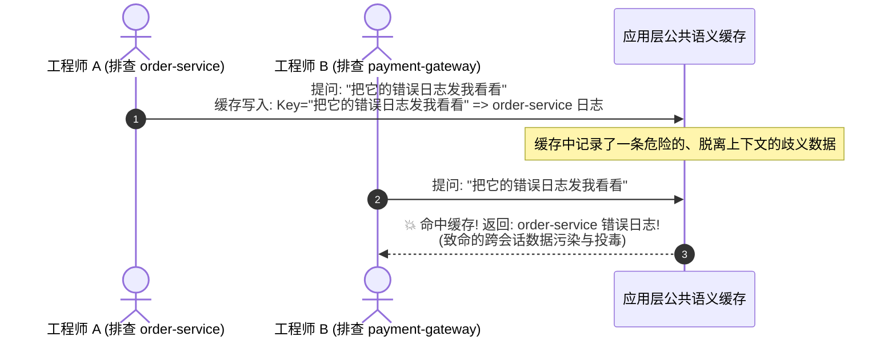
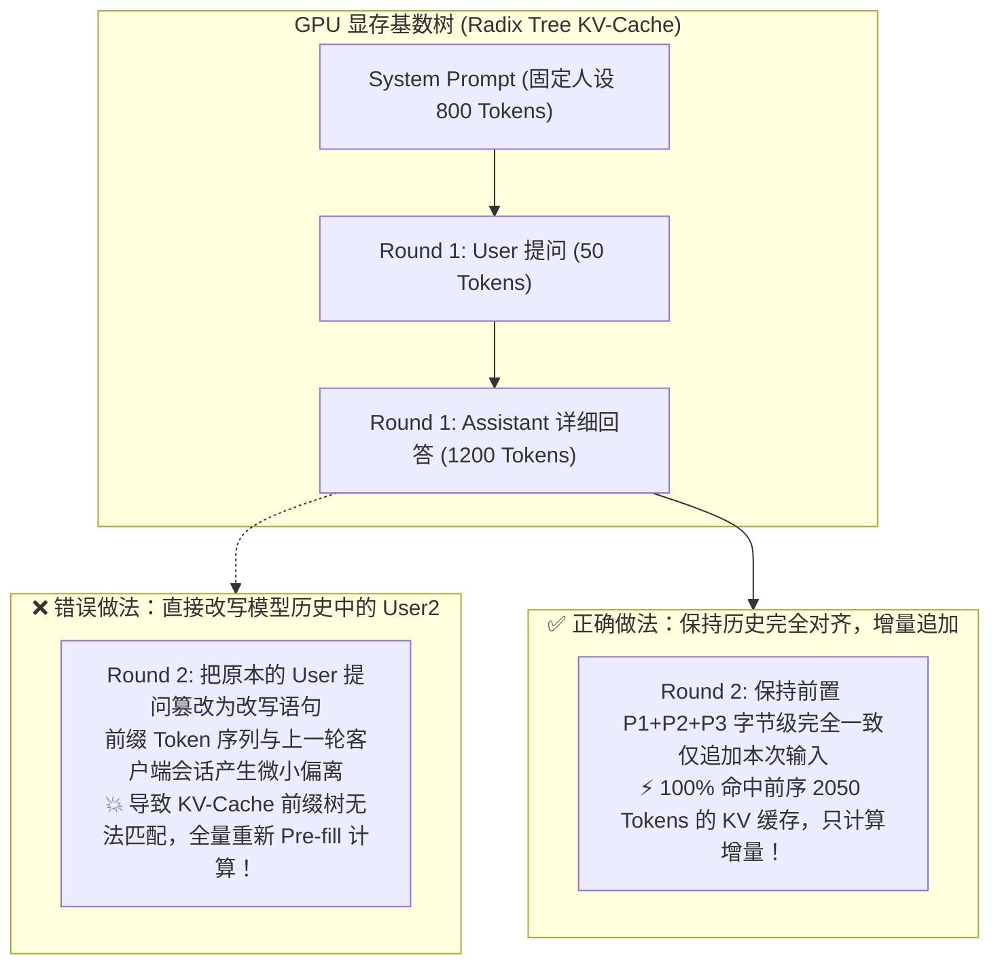
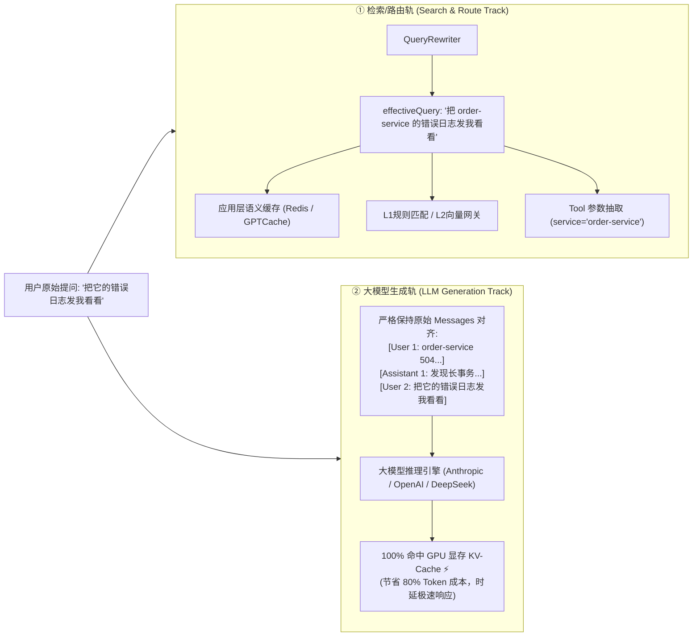

# 查询改写与缓存架构权衡：双轨制如何兼顾应用层语义防投毒与大模型 KV-Cache 极致复用

> **所属专栏**：企业级 Multi-Agent 架构实战手册  
> **核心标签**：`QueryRewriting` `语义缓存` `PromptCaching` `KVCache` `RadixAttention` `双轨制架构` `性能治理`

---

## 一、 引言：一个反直觉的性能谜题

在落地多智能体微内核的过程中，几乎所有架构师在引入“多轮指代消除与查询改写（Query Rewriting）”后，都会遇到一个非常诡异的现象：

> **“下游意图识别和工具参数提取确实变准了，但系统的整体首字时延（TTFT）却明显上升，且云厂商的大模型 API 账单不降反升！”**

深入排查后，问题往往聚焦在**缓存命中率**上。  
很多工程师直觉上会问：“是不是改写改变了用户的提问文本，导致原本能命中的缓存全部失效了？”

要解答这个问题，我们必须彻底解开一个反直觉的架构悖论：  
**改写的本质是“破坏不变性”，而缓存的本质是“依赖不变性”。在不同的缓存层级上，改写扮演着截然相反的角色。**

---

## 二、 厘清三大缓存层级：改写到底影响了谁？

在大模型与 Agent 系统架构中，通常并存着 3 个完全不同维度的缓存层级：

| 缓存层级 | 缓存位置与技术实现 | 缓存判定依据（Key） | 改写对它的真实影响 |
| :--- | :--- | :--- | :--- |
| **1. 应用层语义/结果缓存** | Redis / GPTCache / 本地堆内存 | 用户提问文本或其语义向量 | **改写是救星**：杜绝跨会话缓存污染，大幅提升全局复用率 |
| **2. 意图与规则检索缓存** | L1 规则无锁快照、L2 本地向量库 | 正则表达式、核心服务名实体、向量索引 | **改写是必选项**：不改写将导致下游 100% 穿透击穿 |
| **3. 大模型 KV-Cache 前缀缓存** | 模型服务商（Anthropic / OpenAI / DeepSeek / vLLM） | Prompt Token 序列的物理前缀（Prefix） | **若处理不当，改写会彻底打碎前缀连续性，导致显存缓存雪崩！** |

---

## 三、 深度剖析：改写对不同缓存层级的作用机理

### 1. 应用层语义缓存：“不改写”将引发致命的跨会话投毒（Cache Poisoning）

假设一个天真的架构设计：**直接拿用户输入的原始文本（Raw Query）去查 Redis 语义缓存**。

#### 生产车祸重现：
1. **工程师 A（会话 1）**：
   - Q1: `order-service 504 报警了，排查下`
   - A1: `正在排查 order-service... 发现长事务阻塞。`
   - Q2: `把它的错误日志发我看看`
   - A2: 系统返回了 `order-service` 的最近 50 条堆栈日志，并将 `("把它的错误日志发我看看" ➔ 日志数据)` 存入了公共语义缓存。
2. **工程师 B（会话 2，5 分钟后）**：
   - 工程师 B 正在排查核心支付模块 `payment-gateway` 的内存泄漏故障；
   - 随口在输入框追问了一句：`把它的错误日志发我看看`；
   - **灾难发生**：系统根据原始文本命中了工程师 A 留下的语义缓存，直接将 `order-service` 的日志内容吐给了工程师 B！
   - **后果**：工程师 B 拿着完全错误的日志南辕北辙，线上排障被彻底带偏，核心故障恢复时间严重延误。



#### 架构定论：
- **脱离了多轮上下文的口语化代词，根本没有资格作为跨会话的公共 Cache Key！**
- **必须经过 QueryRewriter 改写**：将输入标准化为规范化自包含语句（Canonical Query）：`"把 order-service 的错误日志发我看看"`；
- 只有改写后的独立问题才能作为 Key 入库。此时不仅彻底消除了跨会话污染，而且当第三位工程师真正提问关于 `order-service` 日志时，能稳稳命中缓存，**在组织协同层面大幅提升了真实缓存命中率**。

---

### 2. 意图与规则缓存：“不改写”导致下游 100% 击穿穿透

在三级意图降级架构中，微内核依赖 L1 正则和 L2 向量库进行极速直出与工具分发：
- 用户输入：`"把它的错误日志发我看看"`；
- **L1 规则引擎**：正则扫描 `service` 实体，未找到任何服务名，**规则失效，放行**；
- **L2 向量检索**：输入句子的语义向量被通用助词“它”、“看看”稀释，严重漂移，匹配度低于阈值，**检索失效，放行**；
- **结果**：原本应该在微内核本地毫秒级闭环的查询，**100% 穿透击穿到了最昂贵的 L3 大模型**。

因此，**改写是保全下游 L1/L2 缓存与意图识别的最强防线**。

---

### 3. 大模型 KV-Cache 前缀缓存：“乱改写”引发的算力雪崩

既然改写在上述两层如此重要，为什么很多团队上线后反映大模型接口变慢了、账单变贵了？  
**原因在于他们破坏了大模型服务商底层的 Prompt Caching（KV-Cache 前缀缓存）。**

#### 大模型 Prompt Caching 的底层机理：
现代大模型推理服务（Anthropic Prompt Caching、OpenAI Prompt Cache、DeepSeek、开源 vLLM Radix Attention）提供高达 50%~90% 的价格折扣和数倍的首字加速。其底层原理是 **Radix Tree（基数树）的前缀命中**：
- GPU 显存保存了之前生成过的 `K` 与 `V` 矩阵（KV-Cache）；
- **核心约束**：模型判定缓存是否命中的标准极其苛刻——**必须从第 0 个 Token 开始，连续字符与 Token 序列绝对完全一致！**



如果工程师在做第二轮对话时，自作主张地把历史消息里的文字改掉了，或者在主对话 Prompt 中随意拼接杂质，哪怕只改动一个标点符号，**后面所有的 KV-Cache 就会全部断裂作废，显存只能对数千 Token 重新进行 Pre-fill 计算**！

---

## 四、 工业界主流厂商的四重标准范式

面对上述矛盾，包括 OpenAI (Assistants API)、Anthropic、字节跳动 (Coze/扣子)、Dify 等一线 AI 平台，目前已收敛出四套标准的工业级解决方案：

### 范式一：双轨制 / 双指针机制 (Dual-Track Pattern) —— 业界终极解

**核心哲学：将“检索路由轨”与“生成推理轨”彻底物理分离。**



- **检索/路由轨**：消费 `effectiveQuery`。只用于：
  1. 检索应用层语义缓存；
  2. 驱动 L1/L2 意图网关分流；
  3. 为下游原子工具（`LogQueryTool`、`DatabaseDiagnoseTool`）精确填补入参；
- **生成推理轨**：给底层大模型推流时，**坚决不破坏用户的原始会话历史**，传递原汁原味的 `messages`。由于 `[User1, Assistant1]` 的前缀与上一轮完全一致，**大模型服务商的 KV-Cache 100% 命中**！

---

### 范式二：前置门控快速绕行（Gating & Fast-Path Heuristic）

绝不能对每一个提问都无差别调用大模型进行改写。必须设置前置门控（Gating）：
1. **指令白名单跳过**：如系统快捷指令 `/help`、`#ping`、`/504` 等以特殊符号开头的提问，改写器直接 0ms 旁路绕过；
2. **无代词特征跳过**：如果句子本身已经包含明确的实体（如 *“order-service 昨天的部署记录”*），且不含代词，跳过改写；
3. **首轮提问跳过**：历史为空时直接短路返回。

---

### 范式三：重写任务下沉到端侧/本地极小模型（SLM / ONNX）

- **绝对反模式**：使用 GPT-4o 或 Claude-3.5 去做 Query 改写（改写一次耗时 800ms，改写比回答还慢）；
- **业界标准解**：使用专职小模型（如 Qwen2.5-0.5B、Llama-3.2-1B）通过 vLLM / TensorRT-LLM 或本地 ONNX 部署，配合专用少样本（Few-Shot）微调，将改写延迟死死锁在 **30ms 以内**。

---

### 范式四：规范化缓存键（Canonical Cache Keying）

- 存储缓存时，**Key 必须基于 `effectiveQuery` 的规范化哈希计算**；
- 缓存命中时，如果用户输入代词，先经由轻量门控改写出 `effectiveQuery`，再击中缓存；
- 从而让不同的用户、不同的问法语义（“查下 order-service 日志” / “把它的日志拿来”在特定上下文中）都能共享同一份权威缓存。

---

## 五、 在 AgentFlow 微内核中的最佳工程实践

在本项目刚刚落地的架构重构中，已经严格贯彻了上述工业界双轨制理念：

1. **上下文分流承载（`AgentContext`）**：
   ```java
   public class AgentContext {
       private String query;          // 原始输入，供大模型生成轨保留真实对话记录
       private String effectiveQuery; // 改写后独立输入，供语义缓存、L1/L2 与工具参数抽取使用
       private List<ConversationMessage> history; // 严格保持原始序列的消息快照
   }
   ```
2. **极速绕行机制（`LlmQueryRewriter`）**：
   在改写器入口前置判定 `/` 与 `#`，杜绝任何对 L1 极速指令的时延污染；
3. **离线自适应启发式降级**：
   在模型未配置或单测离线环境下，通过正则快速提取上文实体，0ms 实现代词回填；
4. **生命周期自然沉淀（`SseAgentEventSink`）**：
   流式通道在接收到 `done()` 信号时，原子归档本轮问答，确保消息列表字节级对齐，为下一次调用的 **Prompt KV-Cache** 创造完美的复用前缀。

---

## 六、 架构避坑清单（Do's and Don'ts）

- [x] **DO**：将改写结果限制在“检索/路由/工具调用轨”，大模型主生成轨保留原生消息历史；
- [x] **DO**：使用规范化改写语句作为应用层语义缓存的 Cache Key，阻断跨会话缓存投毒；
- [x] **DO**：为改写器配置独立的专用轻量小模型与极低采样温度（`temperature = 0.1`）；
- [ ] **DON'T**：绝对不要篡改大模型对话历史中之前轮次的 Assistant/User 文本，避免破坏 KV-Cache 基数树；
- [ ] **DON'T**：绝对不要在没有指代代词、语义已经自包含的提问上无端调用大模型改写；
- [ ] **DON'T**：绝对不要用代词原始输入直接检索应用层公共语义缓存。
